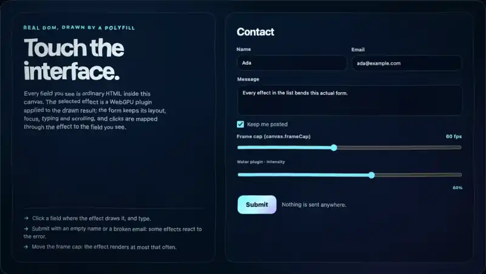

# html-in-canvas-polyfill

[](https://github.com/GiuseppeScottoLavina/html-in-canvas-polyfill/actions/workflows/ci.yml)
[](https://www.npmjs.com/package/@giuseppe-scotto-lavina/html-in-canvas-polyfill)
[](LICENSE)

A polyfill for the proposed [HTML-in-Canvas API](https://github.com/WICG/html-in-canvas): put real, interactive HTML inside `<canvas content="drawable">` and draw it with `ctx.drawElementImage()`, in today's desktop Chrome, Firefox and Safari, and on Chrome for Android and Safari for iOS (verified on a physical Android phone and a physical iPad, and on the Android Emulator and the iOS Simulator).

**Live demo:** [giuseppescottolavina.github.io/html-in-canvas-polyfill](https://giuseppescottolavina.github.io/html-in-canvas-polyfill/) · Try it in the browser: [playground](https://giuseppescottolavina.github.io/html-in-canvas-polyfill/examples/playground/) · **Field test:** [check it on your device](https://giuseppescottolavina.github.io/html-in-canvas-polyfill/examples/field-test/) (about six minutes, one report file to send back; [what it measures](docs/guides/FIELD-TEST.md))

[](https://giuseppescottolavina.github.io/html-in-canvas-polyfill/examples/plugins/?effect=water)

*The [plugin gallery](https://giuseppescottolavina.github.io/html-in-canvas-polyfill/examples/plugins/?effect=water) with the water plugin: an ordinary HTML form inside a canvas, drawn through a WebGPU ripple effect. The click and the typing go to the real `<input>`. Recorded in headless Chrome (`plugins/water/test/gallery.e2e.mjs --record`). Seven more effects over the same form are one click away in the gallery; the smallest page that uses them is [examples/effect-plugin](examples/effect-plugin/).*

## Why

HTML-in-Canvas lets a canvas, a WebGL scene or a WebGPU effect show live, accessible HTML: forms, text, UI. Chrome Canary exposes it without a flag (measured on 157.0.8103.0, 158.0.8112.1 and 159.0.8128.2), and Chromium marks the runtime feature `stable`, so it is expected in an upcoming Chrome release. This package provides the same API now in Chrome stable, Firefox 155+ and Safari 27+, so code written against the standard runs today. It is native-first: wherever the browser implements the API in a usable form, it patches nothing of the standard surface and steps aside, and it never throws because a native build differs in a secondary member.

## Quick start

From npm, for a bundler (TypeScript declarations included):

```sh
npm install @giuseppe-scotto-lavina/html-in-canvas-polyfill
```

```js
import { install } from '@giuseppe-scotto-lavina/html-in-canvas-polyfill';
install(); // synchronous: call it before your code uses the API; throws HicUnsupportedError in a browser it refuses
```

Or from a CDN, with plain script tags placed before your own scripts (no `defer`, `async` or `type="module"`: the polyfill installs while its tag runs):

```html
<script src="https://cdn.jsdelivr.net/npm/@giuseppe-scotto-lavina/html-in-canvas-polyfill@0.1.0-preview.16/dist/hic-live-polyfill.iife.min.js"></script>
<!-- Firefox and Safari: this second bundle draws form controls in those engines' look. Chrome does not need it. -->
<script src="https://cdn.jsdelivr.net/npm/@giuseppe-scotto-lavina/html-in-canvas-polyfill@0.1.0-preview.16/dist/hic-live-engines.iife.min.js"></script>
```

Then use the standard API. This is the explainer's own example, unchanged:

```html
<canvas style="width: 400px; height: 200px;" content="drawable">
  <form drawable>
    <label for="name">name:</label>
    <input id="name">
  </form>
</canvas>

<script>
  const canvas = document.querySelector('canvas');
  const form = document.querySelector('canvas form');
  const ctx = canvas.getContext('2d');

  canvas.onpaint = () => {
    ctx.reset();
    ctx.drawElementImage(form, 100, 0);
  };

  // Size the canvas grid to match the device scale factor.
  new ResizeObserver((entries) => {
    canvas.width = entries[0].devicePixelContentBoxSize[0].inlineSize;
    canvas.height = entries[0].devicePixelContentBoxSize[0].blockSize;
  }).observe(canvas, { box: 'device-pixel-content-box' });
</script>
```

- `content="drawable"` makes the canvas lay out its children as real, live HTML. They stay invisible: the canvas shows only what you draw.
- `drawable` marks each element you will draw.
- The `paint` event fires when the drawables have a current picture. Draw them there with `ctx.drawElementImage(element, x, y)` (`x`, `y` in canvas bitmap pixels). A draw before the first picture exists throws `InvalidStateError`, as natively.
- The `ResizeObserver` keeps the canvas bitmap at device-pixel size, so the drawing is sharp.

Put the script tags and the example in one HTML file and open it (from disk works too). Click the drawn field and type: the text goes into the real input, and the canvas shows it. Clicks reach an element where it is drawn (here 100 bitmap pixels to the right of its layout box). Step by step, with the examples: [docs/guides/GETTING-STARTED.md](docs/guides/GETTING-STARTED.md). All bundles and their load order: [docs/BUNDLES.md](docs/BUNDLES.md).

## Browser support

| browser | status |
|---|---|
| Chrome desktop 154-156 (no native API) | polyfill runs; measured on 154 and 155 (macOS); 156 in CI (headless on Linux and Windows, headed on macOS: 11 of the 16 browser gates) |
| Chrome with a native implementation (Canary 157.0.8103.0, 158.0.8112.1 and 159.0.8128.2 measured; Canary exposes the API with or without the `CanvasDrawElement` flag) | polyfill steps aside (mode `native`) and the page draws natively; the two extensions run over the native implementation (measured on Canary 158.0.8112.1 with the flag) |
| Chrome 154-155 with the `CanvasDrawElement` flag (the earlier `layoutsubtree` draft) | used as found, with one console warning; load `hic-live-native-bridge.iife.min.js` before the core to bridge `content="drawable"` to it |
| Edge, Opera, Brave and other desktop Chromium 130+ | expected to work, not verified |
| Firefox 155+ desktop | polyfill runs; measured on 155 and 157 (macOS) |
| Safari 27+ desktop | polyfill runs; measured on 27.0.1 (macOS) |
| Safari on iOS / iPadOS 26+, other iOS browsers (WebKit) | polyfill runs with phone budgets and the iOS control look; verified on a physical iPad Pro 11-inch (iPadOS 27.2, 2026-10-30) and on the iOS Simulator (iOS 26.4, iPhone and iPad); not on a physical iPhone on iOS 26 or later |
| Chrome for Android 130+ | polyfill runs with phone budgets; verified on two physical phones, a Pixel 7 Pro (Android 17) and a Huawei Mate 10 Pro (Android 10), both Chrome 156, 2026-10-30, and on the Android Emulator with Chromium 158 (which ships HTML-in-Canvas natively: the polyfill steps aside there; its own path was forced for the test) |
| older Firefox and Safari, Chrome for Android < 130, iOS < 26, Android WebView, in-app iOS web views, Firefox for Android | refused with one console warning |

The headed browser gates run on macOS, at a device pixel ratio of 2 (some also at 1 or 1.25), and at 1, 1.25 and 1.5 against Chrome's native implementation. On Linux and Windows only headless Chrome runs, in CI (unit tests, bundle check, and the platform probe: fonts, form controls, scrollbars, DPR 1.25 / 1.5 and the text selection against native pixels). Nothing was measured on a physical Windows machine; physical phones and an iPad ran the mobile gate ([docs/guides/MOBILE.md](docs/guides/MOBILE.md)). Row-by-row evidence: [docs/SUPPORT-MATRIX.md](docs/SUPPORT-MATRIX.md).

## Known limitations

Short answers to the common questions (size, lag behind the DOM, accessibility, native support, privacy, what is verified): [docs/guides/FAQ.md](docs/guides/FAQ.md).

- **The picture lags the DOM by one to two frames.** Each update is cloned, serialised into an SVG image and decoded by the browser before it can be drawn. On Chromium a change that needs no font or image to load is painted one frame later, others about two. Typing in single-line fields and inner scrolling have shortcuts that bring them close to native; other updates do not. Firefox uses the scrolling shortcut only at a device pixel ratio of 1, for square scrollers without rounded corners, form controls or images inside; elsewhere it rebuilds the scroller at every step. During a window drag the canvas shows pixels 1 to 3 frames old.
- **Children are relocated.** The children of the canvas move into an invisible live layer, a `<hic-layer>` element next to the canvas. `children`, `parentNode` and friends answer as if nothing moved, but CSS `:last-child`, `:nth-child`, `+` and live collections see the layer.
- **Size.** The core is about 116 KB gzipped (342 KB minified). Drawables that change often should stay well under about 1000 elements ([docs/guides/PERFORMANCE.md](docs/guides/PERFORMANCE.md)).
- **Not drawn:** cross-origin (or sandboxed) iframes, `<object>` and `<embed>`, and cross-origin images, fonts and CSS without CORS. The browser itself leaves them out of a canvas; the polyfill draws the element's box without its content and logs one console message, never a silent gap. Also not drawn: native UI such as select popups, date pickers and IME composition. Same-origin iframes are drawn. A strict CSP must allow `img-src data:`.
- **Animated images:** an animated GIF, APNG, WebP or AVIF `` plays where the browser has `ImageDecoder` (WebCodecs), in a secure context; Safari 27, which has none, shows its first frame. Animated CSS images (`background-image` and the like) show their first frame everywhere.
- **Phones and tablets:** verified on a physical Pixel 7 Pro (Android 17, Chrome 156), a physical Huawei Mate 10 Pro (Android 10, Chrome 156) and a physical iPad Pro 11-inch (iPadOS 27.2), and on the Android Emulator and the iOS Simulator (iPhone 17, iOS 26.4). No physical iPhone on iOS 26 or later was run; a physical iPhone on iOS 18 confirmed the clean refusal. Pinch-zoom shows the canvas bitmap scaled, not re-rastered (as native canvases do). Memory budgets for phones are chosen from WebKit's limits, not measured ([docs/guides/MOBILE.md](docs/guides/MOBILE.md)).
- **Not supported:** web views inside apps, Firefox for Android, an `ElementImage` sent through a MessagePort or BroadcastChannel (a dedicated worker that loads `hic-live-worker` takes one and draws it).
- **Preview.** `0.1.0-preview.16` follows a proposed standard that may still change. The two extensions below may change between previews.

## How it works

```
<canvas content="drawable">        <hic-layer> next to the canvas, opacity 0, over its content box
  <form drawable> ...    ──moved──▶  the same live elements: layout, focus, typing, IME, scrolling, hit testing
                                       │ mutation / input / scroll / resize observers report damage
                                       ▼
                                     clone of the changed region ──▶ SVG foreignObject ──▶ data: URL ──▶ decode
                                       │
                                       ▼
                                     retained 2D surface per drawable (the old picture stays until the new one lands)
                                       │
canvas.onpaint ──▶ ctx.drawElementImage(form, x, y)   (also WebGL / WebGPU uploads and effect plugins)
```

The browser itself lays out and paints the HTML; the polyfill only takes pictures of it, so text, CSS and form controls look like the plain page. The main design choices and why they were made: [docs/DESIGN-DECISIONS.md](docs/DESIGN-DECISIONS.md). Details: [docs/ARCHITECTURE.md](docs/ARCHITECTURE.md).

## Compared with the alternatives

Measured on one machine (Apple M1 Max, macOS, 120 Hz, DPR 2) with the same pages, harness and input for all three. The other polyfill on npm implements the older `layoutsubtree` name, so it ran through a small attribute adapter ([included](test/bench/compare/competitor/)).

| | this polyfill | [`html-in-canvas-polyfill`](https://www.npmjs.com/package/html-in-canvas-polyfill) 1.0.1 | native (Chrome Canary) |
|---|---|---|---|
| official WPT HTML-in-Canvas files passing | 214 of 248 (WPT of 2026-10-28) | 66 of 230 (WPT of 2026-10-07, not measured again) | 236 of 248 on Canary 159.0.8128.2, in each of its two full runs (WPT of 2026-10-28) |
| keydown to canvas pixel, p50 / p95 | 4.6 / 9.0 ms | 11.5 / 15.3 ms, final text wrong | 5.5 / 9.9 ms |
| wheel scroll inside the canvas, p50 to pixel | 23.0 ms | never drawn | 37.8 ms |
| blank frames during real window resizes | 0 of 3129 | 542 of 3130 | 0 of 3127 |
| one update in a 1000-element drawable, main thread | 24.9 ms | 44.9 ms | 6.0 ms |
| first paint of a form page (new tab), p50 | 92 ms | 60 ms | 66 ms |
| core bundle, minified / gzipped | 342 KB / 116 KB | 30 KB / 10 KB | none |
| browsers | desktop Chrome, Firefox 155+, Safari 27+; Chrome for Android 130+ (a physical phone and the emulator), iOS / iPadOS Safari 26+ (a physical iPad and the iPhone simulator) | claims all, including mobile (not verified here) | Chrome Canary 157+ (no flag needed) |

The WPT row is this polyfill on 2026-10-29 ([docs/CONFORMANCE.md](docs/CONFORMANCE.md)), the other package as measured on 2026-10-13, and native Chrome at the build whose copy of the tests is pinned (newer Canary builds already implement later API changes that the pinned tests predate); the latency, resize, update and first-paint rows were measured on 2026-10-30/31 with 0.1.0-preview.15 (Chrome 156; native: Canary 159.0.8131.0), each subject twice; the bundle row is the current build. The other package is smaller, starts faster and offers a Three.js renderer. Full tables, method and caveats: [docs/PERFORMANCE-COMPARISON.md](docs/PERFORMANCE-COMPARISON.md) and [docs/COMPARISON.md](docs/COMPARISON.md). Libraries such as html2canvas are a different tool: they re-implement CSS painting to take a static picture, and the result is not interactive.

## Two extensions (not part of the standard)

> **Note.** The frame cap and the effect plugins are extensions of this library. They are not part of the HTML-in-Canvas proposal, and browsers' native implementations do not and will not provide them. They run over this polyfill and over a browser's own implementation that the polyfill steps aside for ([what differs there](docs/guides/EFFECTS-PLUGINS.md#on-a-native-implementation)).

- **Frame cap:** `<canvas content="drawable" framecap="30">` or `canvas.frameCap = 60` bounds `paint` events, effect frames and snapshot builds for that canvas (0 = display rate).
- **Effect plugins:** an optional WebGPU host runs post-processing plugins over the drawn HTML and remaps pointer input through the effect, so clicks reach the element the user sees. A plugin may declare actions that page code runs through its handle (`await handle.trigger('play')` resolves with the state the plugin rests in). The plugins are not part of the polyfill: the water ripple of the demo is one example plugin in [plugins/](plugins/), with a template for new ones and a [gallery](examples/plugins/) that applies each to one live form; [examples/effect-plugin](examples/effect-plugin/) is the smallest page that uses them. [docs/guides/EFFECTS-PLUGINS.md](docs/guides/EFFECTS-PLUGINS.md) is the reference for using and writing plugins.

## Example plugins

Eight example effect plugins, each applied to the same live form in the [plugin gallery](https://giuseppescottolavina.github.io/html-in-canvas-polyfill/examples/plugins/) (desktop Chrome with WebGPU). Under each of them the form stays live: a click is mapped through the effect to the element the user sees there (and swallowed where the effect shows no element), typing goes to the real field, and each plugin states what it does when the user prefers reduced motion. Five have actions that page code runs with `handle.trigger`: disintegrate (`out`, `in`, `play`), shatter (`impact`, `crack`, `out`, `in`, `play`), glitch (`burst`), page-curl (`peek`) and water (`drop`); the gallery shows them as buttons.

<table>
<tr>
<td align="center"><a href="https://giuseppescottolavina.github.io/html-in-canvas-polyfill/examples/plugins/?effect=crt"></a><br><a href="plugins/crt/">CRT monitor</a></td>
<td align="center"><a href="https://giuseppescottolavina.github.io/html-in-canvas-polyfill/examples/plugins/?effect=disintegrate"></a><br><a href="plugins/disintegrate/">Disintegrate</a></td>
<td align="center"><a href="https://giuseppescottolavina.github.io/html-in-canvas-polyfill/examples/plugins/?effect=glitch"></a><br><a href="plugins/glitch/">Glitch</a></td>
<td align="center"><a href="https://giuseppescottolavina.github.io/html-in-canvas-polyfill/examples/plugins/?effect=holo-card"></a><br><a href="plugins/holo-card/">Holo card</a></td>
</tr>
<tr>
<td align="center"><a href="https://giuseppescottolavina.github.io/html-in-canvas-polyfill/examples/plugins/?effect=liquid-glass"></a><br><a href="plugins/liquid-glass/">Liquid glass</a></td>
<td align="center"><a href="https://giuseppescottolavina.github.io/html-in-canvas-polyfill/examples/plugins/?effect=page-curl"></a><br><a href="plugins/page-curl/">Page curl</a></td>
<td align="center"><a href="https://giuseppescottolavina.github.io/html-in-canvas-polyfill/examples/plugins/?effect=shatter"></a><br><a href="plugins/shatter/">Shatter</a></td>
<td align="center"><a href="https://giuseppescottolavina.github.io/html-in-canvas-polyfill/examples/plugins/?effect=water"></a><br><a href="plugins/water/">Water</a></td>
</tr>
</table>

What each plugin does and how its input mapping works: [plugins/README.md](plugins/README.md). Writing one: [docs/guides/EFFECTS-PLUGINS.md](docs/guides/EFFECTS-PLUGINS.md).

## Testing and conformance

- **Official WPT tests:** the 248 HTML-in-Canvas test files at the newest WPT commit that touches them (2026-10-28). The polyfill passes 214 files (333 of 381 subtests); native Chrome passes 236 (369) in every full run on Canary 159.0.8128.2, a build whose copy of the tests is byte-identical to that commit; without the polyfill at most 11 pass, all vacuously. Every difference has a written reason, and no polyfill bug is open ([docs/CONFORMANCE.md](docs/CONFORMANCE.md)).
- **Unit tests:** 593 in Node and 910 in headless Chrome (the plugin tests included), run in CI on Linux and Windows with type checks, module-boundary checks and a bundle check (CI has no GPU, so the WebGPU tests skip there).
- **Browser gates:** 16 gates in real, headed Chrome (20 runs: two of them run at two device pixel ratios, G-pixel-dpr at three) compare the canvas with the same HTML rendered as a plain page or, at DPR 1, 1.25 and 1.5, with Chrome's native implementation (pixels, text weight, hit testing through strong effects, typing, resize, scrolling and its cadence); two more run the effects over Chrome Canary's own implementation (G-native-effects, G-native-interposer). Each has a positive control (a deliberately broken renderer that must make it fail), and a mutation suite checks that all 61 seeded bugs are caught. `npm run test:gates:all` runs them with the WPT gate, the static checks, the unit tests and the mutation suite. In CI, the platform probe (G-platform) checks fonts, form controls, scrollbars, fractional DPR and text selection against native pixels on Linux, Windows and macOS.
- **Firefox and Safari:** 11 scenarios each through WebDriver, against the plain page in the same engine; Safari Technology Preview as an optional engine, which with its HTML-in-Canvas internal feature on checks the native path instead (install steps aside, the explainer and a form drawn natively through the bridge, clicks, typing, uninstall).
- **Phones:** `npm run test:mobile` drives Mobile Safari in the iOS Simulator or on a physical iPhone or iPad over USB (`--ios-device`) and Chrome in the Android Emulator or on a physical Android phone over USB (`--android-serial`): taps on moved drawables, typing, touch scroll, composed scroll frames against the settled picture (iOS), the virtual keyboard, rotation, the iOS form-control look and the refusal of older browsers, each with a positive control.
- **Frameworks:** React 19 (including hydration), Vue 3, Svelte 5 and Lit 3 apps ([docs/guides/FRAMEWORKS.md](docs/guides/FRAMEWORKS.md)).

The gate list, oracles and thresholds are in [docs/TEST-PLAN.md](docs/TEST-PLAN.md). CI runs everything that works headless on Linux and on Windows, and the browser gates (11 of the 16, with their controls), the mutation suite, the example, site and framework suites and Firefox on GitHub-hosted macOS runners; what needs a 120 Hz display, a fast machine for throughput checks, continuous WebGPU frames, Safari 27, Chrome Canary's oracle for WPT or the phone simulators runs locally on macOS (`npm run test:local`; [CONTRIBUTING.md](CONTRIBUTING.md#where-the-suites-run)).

## Documentation

- Guides: [FAQ](docs/guides/FAQ.md), [getting started](docs/guides/GETTING-STARTED.md), [frameworks](docs/guides/FRAMEWORKS.md), [effect plugins](docs/guides/EFFECTS-PLUGINS.md), [performance](docs/guides/PERFORMANCE.md), [phones and tablets](docs/guides/MOBILE.md), [troubleshooting](docs/guides/TROUBLESHOOTING.md), [field test](docs/guides/FIELD-TEST.md)
- Reference: [API contract](docs/API-CONTRACT.md), [support matrix](docs/SUPPORT-MATRIX.md), [bundles](docs/BUNDLES.md), [conformance](docs/CONFORMANCE.md)
- Design: [design decisions](docs/DESIGN-DECISIONS.md), [architecture](docs/ARCHITECTURE.md), [test plan](docs/TEST-PLAN.md)
- Comparisons: [with html-in-canvas-polyfill](docs/COMPARISON.md), [performance](docs/PERFORMANCE-COMPARISON.md)
- Examples: [examples/](examples/) (`npm ci && npm run build && npm run demo`); effect plugins: [plugins/](plugins/)

The bundle files and console messages use the short name `hic-live` (HTML-in-canvas, live DOM).

## Contributing

Issues and pull requests are welcome; please read [CONTRIBUTING.md](CONTRIBUTING.md) first. For a bug, include the output of `JSON.stringify(__HIC__.installed.report(), null, 1)` from the page console ([troubleshooting](docs/guides/TROUBLESHOOTING.md)). Security problems: [SECURITY.md](SECURITY.md). This project follows the [Code of Conduct](CODE_OF_CONDUCT.md).

## License

[MIT](LICENSE) © 2026 Giuseppe Scotto Lavina
