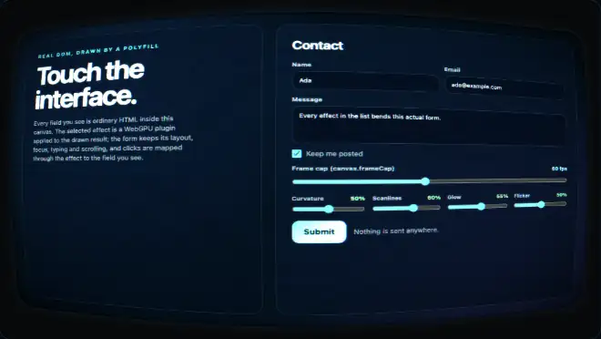

# crt

An **example** effect plugin: the HTML drawn in a canvas shown on a curved CRT monitor. Barrel curvature inside a bezel, scanlines that follow the curved glass, interlaced fields, an aperture-grille mask, phosphor glow, slight red / blue misconvergence, a vignette, and (unless the user prefers reduced motion) a gentle flicker, a slow rolling bar and faint static. The form stays usable: a click on the curved picture reaches the element drawn there, and a click on the bezel reaches nothing.

It shows how to use the effects extension of this library (`HTMLInCanvasEffects`, plugin ABI v2). It is **not part of the polyfill**: the polyfill, the frame cap and the effects host work without it, and nothing in `src/` imports it. The effects host and this plugin are extensions of this library, not part of the HTML-in-Canvas proposal; browsers' native implementations do not provide them ([docs/guides/EFFECTS-PLUGINS.md](../../docs/guides/EFFECTS-PLUGINS.md)).



## Use

```html
<script src="dist/hic-live-polyfill.iife.min.js"></script>
<script src="dist/hic-live-effects.iife.min.js"></script>
<script src="dist/plugins/crt.iife.min.js"></script>   <!-- window.HicLivePlugins.crt -->
<script>
  const host = await HTMLInCanvasEffects.createHost(canvas, form, { interposer: true });
  const crt = await host.addPlugin(HicLivePlugins.crt.plugin, { curvature: 0.5, scanlines: 0.6 });
  crt.mountUI(document.getElementById('controls'));   // curvature, scanlines, glow and flicker sliders, interlace toggle
</script>
```

ES modules: `import { plugin } from '@giuseppe-scotto-lavina/html-in-canvas-polyfill/plugins/crt'`.

| option | | |
|---|---|---|
| `curvature` | 0 to 1, default 0.5 | strength of the barrel (`k` = 0.5 x curvature); 0 is a flat screen inside the bezel |
| `scanlines` | 0 to 1, default 0.6 | depth of the scanlines and of the aperture-grille mask |
| `glow` | 0 to 1, default 0.55 | phosphor glow (two rings of taps around each pixel; bright parts bleed most) |
| `flicker` | 0 to 1, default 0.5 | flicker, rolling bar and static; 0 (or reduced motion) stops the animation |
| `misconvergence` | 0 to 1, default 0.5 | red and blue land up to 1.4 CSS px to each side of green |
| `interlace` | boolean, default `true` (`meta.defaults`, so on in the gallery) | two interlaced fields alternating at 60 Hz (below) |

## Interlace

With `interlace` on, the frame is two fields of lines half a scanline apart (twice as many lines as the progressive scanlines, with shallower gaps, so the look stays that of the `scanlines` setting):

- **Fields**: the field drawn now is at full brightness; the lines of the other field still glow from the previous field, dimmer (how much dimmer follows `scanlines`). A new field starts every 1/60 s and each new field flips the parity once (`nextField`), so at a 30 fps frame cap the fields still alternate frame by frame instead of aliasing to one parity; at 120 Hz each field is shown on two frames.
- **Interline twitter**: each line samples the source at its own centre, so a thin horizontal edge (a 1 px border, the stroke of a letter) lies on the lines of one field only and flickers as the fields alternate, as on a real interlaced tube.
- **Field offset and combing**: the odd field sits 0.3 CSS px to the right (a little sync jitter: fine combing on vertical edges), and the lines of the previous field show the source as it was then. The plugin keeps that source in a history texture (a second, tiny pipeline copies each new source version after the pass that still read the old one; the source texture has no `COPY_SRC`), so content that changes or moves between two fields (typing, a caret, a dragged slider) combs for one field.
- **Reduced motion**: one field stays (the parity never flips) and there is no history: the still interlace look, without flicker or combing.
- **Input**: interlace is not spatial. Every sample moves by less than half a line from the point the barrel gives, and the mapper does not read it; the GPU test checks the mapper with interlace on, on two consecutive fields and on a combed frame.

## How the input mapping stays exact

`mapCrtPoint(state, point)` is the JavaScript twin of the barrel in `crt.wgsl`. The screen is the canvas minus the bezel; with `d` the point relative to the centre and `s` the half size of the screen, the source point is `(d / s) (1 + k |d|^2 / |s|^2) / (1 + k s^2 / |s|^2)` scaled to the whole source: the middle of the screen is magnified, the edges compressed, the midpoint of every edge lands on the edge of the source, and the corners are rounded off. Points on the bezel or in the rounded corners map to `NO_TARGET` (the effects ABI value for "no element here"): the host swallows a press there, so it reaches no element, even with another spatial plugin before this one in the chain. The mapper reads the uniform block of the presented frame (copied into one of four slots), so a curvature change does not alter the mapper of an earlier frame. Glow, scanlines, flicker and misconvergence change colours only; the green channel is the one the mapper describes.

## Motion, frame cap, cost

- The animation (flicker, bar, static, the alternating fields) runs only while `flicker > 0` or `interlace` is on, and the user does not prefer reduced motion: then the instance is `continuous` and is rendered on every capped frame. Otherwise it renders only when the form or an option changes.
- `prefers-reduced-motion: reduce`: no flicker, no rolling bar, no static, no field alternation and no combing; the picture is still (with a still interlace look when `interlace` is on).
- No allocation per frame: one uniform array, two reused render pass descriptors, bind groups cached per source view. The history texture (one, the size of the source) is created on the first interlaced frame and again only when the source is resized; the copy pass runs only when the source version changes.
- Device loss: the host re-creates the plugin with its latest options.
- GPU time, measured on 2026-10-14 (Apple M1 Max, headless Chrome 155, 2200 x 1240 target = the gallery canvas at DPR 2, 600 frames back to back, interlace on): 0.44 ms per frame (0.33 ms before the interlace), against 0.06 ms for a pass that only clears the target (`measureGpuTime` of `plugins/_shared/gpu-time.mjs`).

## Files

| file | |
|---|---|
| `index.js` | `meta`, `plugin`, `mapCrtPoint`, `bezelWidth`, `cornerRadius`, `nextField`, `FIELD_HZ`, `NO_TARGET` (re-exported from the effects ABI), `UNIFORM_FLOATS` |
| `crt.wgsl` | the shader (`fs`) and the copy into the field history (`fs_copy`); inlined into the built bundles |
| `wgsl.js` | loads the shader when the plugin runs from source; the build replaces it |
| `test/crt.test.mjs` | Node: the folder contract, the mapper against an independent formula, animation and reduced motion, option clamping, the field clock at 120/60/30 fps, the history copy (once per source version, after the pass), the mapper the same with interlace on and off, no per-frame allocation, per-frame freeze of the mapper |
| `test/crt-gpu.browser.test.mjs` | headless Chrome: the mapper against the GPU pixels with interlace on (`checkMapperAgainstGpu`, with the identity mapper as the control; mapper 0 wrong px, identity 3284), another curvature as a second control, the full look on the green channel, two instants of the flicker, two consecutive fields (2932 px differ, one mapper fits both), combing (a moved source shows old and new positions on one frame, only the new one a field later), device loss, GPU time |
| `test/gallery.e2e.mjs` | headless Chrome, trusted input, in the plugin gallery: clicks where the CRT draws a control; console errors, frame rate and reduced motion; the interlace toggle mounted and on, the fields animating with the flicker at 0, idle with both off (`npm run build` first; `npm run test:plugins` runs every gallery e2e; `--record` rewrites `media/crt.webp`). Steps shared with other plugins: `plugins/_shared/gallery-click.mjs` |
| `media/crt.webp` | recorded in headless Chrome from the plugin gallery (`--record`): the interlaced screen, then typing into the message |
