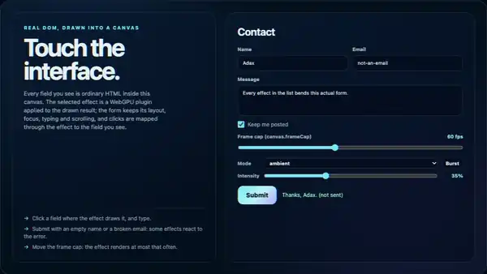

# glitch

A controlled digital glitch over the HTML drawn in a canvas: a spectral RGB split, block displacement, scanline tearing, a VHS tracking band, pixel-sorting streaks, corrupted macroblocks, grain and scanlines; a burst plays on a validation error, and clicks follow the displaced blocks.

An **example** effect plugin of this library, not part of the polyfill: nothing in `src/` imports it, and the polyfill, the frame cap and the effects host work without it. The effects host and its plugins are extensions of this library, not part of the HTML-in-Canvas proposal; native implementations do not provide them ([details](../../docs/guides/EFFECTS-PLUGINS.md#extensions-not-the-standard)).



Recorded in headless Chrome from the plugin gallery (`node plugins/glitch/test/gallery.e2e.mjs --record`): the ambient mode, a Submit with an invalid email, the action `demo`.

## What it does

Layers:

- **RGB split**, as a spectral spread: red is sampled over three taps to one side, blue over three to the other, green stays in place, so the fringes fade like the dispersion of a cheap lens instead of a hard double edge;
- **block displacement** and **scanline tearing** (full-width bands shifted sideways);
- a **VHS tracking band**: a stack of thin full-width slices, each jittered sideways, washed out, with bright dropout dashes during a burst;
- **pixel-sorting streaks** (a pixel takes the brightest of the pixels above it, so bright runs smear downwards);
- **corrupted macroblocks** (8 or 16 px): the detail (luma) of each pixel with the colour (chroma) of the block's centre, boosted and drifted per block, as a damaged video stream shows;
- **grain** and soft **scanlines**.

| mode | |
|---|---|
| `'ambient'` (default) | a still, damaged signal (a fine colour fringe, scanlines, a frozen grain) and about every 1.4 s an event of 90 to 220 ms: a few shifted slices and blocks, a tracking band, or a chroma jolt. The events never cover the focused element of the drawn page (its box plus 6 px), and none starts within 1.2 s of a key press or an `input` in the page, so typing and reading the field you are in are never disturbed |
| `'burst'` | nothing until a burst plays |

A **burst** (520 ms; a new pattern every 45 ms, every fifth pattern clean so that it flickers; full strength for 60 % of the time, then fading) plays in either mode on the action `burst`, on the Burst button of `mountUI`, and on its own when an element of the drawn page starts to match `watch` (by default a validation error: `[aria-invalid="true"], .invalid, [data-state="error"]`; a `MutationObserver` on the source watches `class`, `aria-invalid` and `data-state`) or an `invalid` event fires in the page. In the plugin gallery a Submit with an invalid email sets `.invalid` and `data-state="error"`, so the form glitches without any change to the gallery page. All randomness is a hash of (seed, burst, pattern, index): the same instant gives the same picture and the same mapper at every frame cap.

## Usage

```html
<script src="dist/hic-live-polyfill.iife.min.js"></script>
<script src="dist/hic-live-effects.iife.min.js"></script>
<script src="dist/plugins/glitch.iife.min.js"></script>   <!-- window.HicLivePlugins.glitch -->
<script type="module">
  const host = await HTMLInCanvasEffects.createHost(canvas, form, { interposer: true });
  const glitch = await host.addPlugin(HicLivePlugins.glitch.plugin, { mode: 'ambient', intensity: 0.35 });
  glitch.mountUI(document.getElementById('controls'));   // mode, intensity, Burst button
  form.addEventListener('submit', (event) => { if (!valid(form)) glitch.trigger('burst'); });   // or rely on `watch`
</script>
```

ES modules: `import { plugin } from '@giuseppe-scotto-lavina/html-in-canvas-polyfill/plugins/glitch'`.

## Options

| option | default | |
|---|---|---|
| `mode` | `'ambient'` | `'ambient'` or `'burst'` (above) |
| `intensity` | 0.35 | 0 to 1: strength of the ambient layers and of the bursts |
| `split`, `sort`, `noise` | true | the RGB split, the sort streaks, the grain and scanlines |
| `seed` | 1 | integer: the random patterns |
| `watch` | `[aria-invalid="true"], .invalid, [data-state="error"]` | CSS selector of elements whose appearance plays a burst; `''` turns it off |

`mountUI` adds a mode picker, an intensity slider and a Burst button (the action `burst`).

## Actions

`handle.trigger('burst')`, `handle.trigger('demo')` ([semantics](../../docs/guides/EFFECTS-PLUGINS.md#5-actions-trigger-and-settled)); no options.

| action | | resolves with |
|---|---|---|
| `burst` | plays one burst now; bursts closer than 250 ms are one (the one that runs) | `'idle'`, at the frame that ends the burst |
| `demo` | a scripted sequence of about 3 s: a micro-glitch, a short hit, a full burst, a stutter of two hits and the strongest burst (macroblocks, sort streaks, the tracking band), then calm | `'idle'`, at the frame that ends it; `null` when a press or a key in the page takes over, or a newer trigger |

`handle.settled()` resolves with `'idle'` once no burst plays (the ambient look of mode `'ambient'` keeps running). A newer `trigger` resolves a pending one with `null`; the automatic bursts (`watch`, `invalid`) join the running burst or demo and do not supersede it. The plugin never starts the demo by itself.

## Input

`mapGlitchPoint(state, point)` is the JavaScript twin of `glitch.wgsl`. Only the shift blocks move the page: outside them the mapper is the identity; inside, it returns the point the block shows, its integer offset undone and wrapped around the page like the shader. So a click on a displaced field reaches the field the user sees there, **also during a burst** (no input is suspended). The colour layers do not move the page: under a sort streak, the split, the grain or the scanlines, input goes to the element at that place. The shader draws the page and then each block as an instanced rectangle on top of the previous ones; the mapper takes the last block that covers the point. Every block edge and offset is a whole CSS pixel, so the shader samples texel centres and the mapper is exact.

## Reduced motion

With `prefers-reduced-motion: reduce`: no block ever moves (the mapper is the identity), the grain does not animate, there are no ambient events, and a burst is one steady frame of split colour for its 520 ms (the action resolves `'idle'` when it ends); the demo is the same steady frame for its length.

## Performance

`test/glitch-gpu.browser.test.mjs`, headless Chrome on an Apple M1 Max (Metal), 2200x1240 backing pixels (1100x620 CSS px at DPR 2), burst frames with every layer on, measured on 2026-11-04: 0.14 ms per frame submitted back to back (the one-sample template pass: 0.09 ms); under 2 % of the 8.33 ms frame at 120 Hz. One run on one machine.

On the iPad Pro 11-inch (3rd generation, Safari, iPadOS 27.2, 120 Hz, frame cap 120), measured from `effectframe` events on 2026-11-04: the ambient mode at the default intensity renders 14 frames per second (it rendered 120 before this version), at 8.3 ms intervals while an event plays; a burst and the demo render 118 to 120 frames per second with frame intervals of 8.34 ms (p50) and 8.5 to 8.6 ms (p95); burst mode at rest renders nothing (0 frames in 3 s). Headless Chrome at 60 Hz: about 6 frames per second in the ambient mode.

Frames are requested only while something plays: a burst, the demo or an ambient event, every frame within the frame cap. Between ambient events the picture is still: the plugin sets one timer for the next event and the host renders nothing, so the ambient mode costs a few frames per second instead of every frame (measured above). Burst mode at rest costs nothing. Per frame the render path allocates nothing (one uniform array rewritten in place, one reused pass descriptor; mappers are copied into 4 preallocated slots). After a GPU device loss the host re-creates the plugin with the same options.

## Limitations

- The split, the sort streaks, the grain and the scanlines are not mapped: a click goes to the element at that place, not to what a streak shows.
- `watch` sees changes of `class`, `aria-invalid` and `data-state` only.
- At most 32 blocks per pattern.
- The keep-out of the focused element reads its box with `getBoundingClientRect` on the frames of an ambient event; an element transformed inside the drawn page is kept out by its bounding box.
- WebGPU only (without an adapter `createHost` rejects with a `NotSupportedError`). Runs over the polyfill and over a browser's own HTML-in-Canvas implementation ([what differs there](../../docs/guides/EFFECTS-PLUGINS.md#on-a-native-implementation)); not run there by the test suites (the native suite runs water, CRT and disintegrate); expected to behave the same, as the plugin uses only the plugin interface.

## Files and tests

| file | |
|---|---|
| `index.js` | `meta`, `plugin`, `ACTIONS`, the mapper `mapGlitchPoint`, the pure frame function `fillGlitchFrame`, the block generator `fillBlocks`, `ambientEvent`, the scripts `BURST_SCRIPT` and `DEMO_SCRIPT`, `KIND`, `STYLE` |
| `glitch.wgsl` | the shader; inlined into the built bundles |
| `wgsl.js` | loads the `.wgsl` file when the plugin runs from source; the build replaces it |
| `media/glitch.webp` | the recording above |
| `test/glitch.test.mjs` | Node: the folder contract, the generator (every kind of block, the keep-out), the mapper against an independent port of the shader on every pixel, bursts, the demo script, ambient events, the typing hold, the keep-out of the focused field, reduced motion, the same frame at 120/60/30/15 fps, the time to the next frame (the picture does not change before it), the frames asked for (with mocked timers), the triggers, both actions through the real handle (state, superseding, removal, interruption, reduced motion), no allocation per frame |
| `test/glitch-gpu.browser.test.mjs` | headless Chrome: `checkMapperAgainstGpu` on the displacement (identity as positive control), every layer on read on the green channel (colour blocks masked), the next pattern's mapper as wrong-mapper control, ambient, device loss, both actions through the real host (`runActionOnGpu`: every checked frame agrees with its mapper, they resolve `'idle'` on the page at rest), the GPU time |
| `test/gallery.e2e.mjs` | the gallery with trusted input: ambient renders only during its events, a burst within the frame cap, typing through the effect, a Submit with an invalid email plays a burst, the Burst button, burst mode at rest presents no frame, the action from the gallery's button, an unknown action, superseding, `settled()`, reduced motion (also the action). 21 of 21 checks pass (headless Chrome 156, 2026-11-04). `--record` writes the media; needs `npm run build` |
