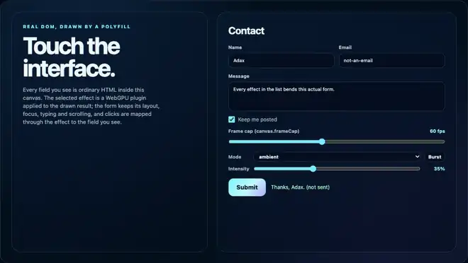

# glitch

A controlled digital glitch over the HTML drawn in a canvas: RGB channel split, block displacement, scanline tearing, pixel-sorting streaks, grain and scanlines; a burst plays on a validation error, and clicks follow the displaced blocks.

An **example** effect plugin of this library, not part of the polyfill: nothing in `src/` imports it, and the polyfill, the frame cap and the effects host work without it. The effects host and its plugins are extensions of this library, not part of the HTML-in-Canvas proposal; native implementations do not provide them ([details](../../docs/guides/EFFECTS-PLUGINS.md#extensions-not-the-standard)).



Recorded in headless Chrome from the plugin gallery (`node plugins/glitch/test/gallery.e2e.mjs --record`): the ambient mode, a Submit with an invalid email, the Burst button.

## What it does

Layers: RGB channel split (red and blue sampled a few pixels apart, green in place), block displacement, scanline tearing (full-width bands shifted sideways), pixel-sorting streaks (a pixel takes the brightest of the pixels above it, so bright runs smear downwards), grain and scanlines.

| mode | |
|---|---|
| `'ambient'` (default) | subtle and continuous: a faint split, grain and scanlines, and about every 1.7 s a micro-glitch of 70 to 160 ms (a few small block shifts) |
| `'burst'` | nothing until a burst plays |

A **burst** (520 ms; a new pattern every 45 ms, every fifth pattern clean so that it flickers; full strength for 60 % of the time, then fading) plays in either mode on the action `burst`, on the Burst button of `mountUI`, and on its own when an element of the drawn page starts to match `watch` (by default a validation error: `[aria-invalid="true"], .invalid, [data-state="error"]`; a `MutationObserver` on the source watches `class`, `aria-invalid` and `data-state`) or an `invalid` event fires in the page. In the plugin gallery a Submit with an invalid email sets `.invalid` and `data-state="error"`, so the form glitches without any change to the gallery page. All randomness is a hash of (seed, burst, pattern, index): the same instant gives the same picture and the same mapper at every frame cap.

## Usage

```html
<script src="dist/hic-live-polyfill.iife.min.js"></script>
<script src="dist/hic-live-effects.iife.min.js"></script>
<script src="dist/plugins/glitch.iife.min.js"></script>   <!-- window.HicLivePlugins.glitch -->
<script>
  const host = await HTMLInCanvasEffects.createHost(canvas, form, { interposer: true });
  const glitch = await host.addPlugin(HicLivePlugins.glitch.plugin, { mode: 'ambient', intensity: 0.35 });
  glitch.mountUI(document.getElementById('controls'));   // mode, intensity, Burst button
  form.addEventListener('submit', (event) => { if (!valid(form)) glitch.trigger('burst'); });   // or rely on `watch`
</script>
```

ES modules: `import { plugin } from '@giuseppe-scotto-lavina/html-in-canvas-polyfill/plugins/glitch'`.

## Options

| option | default | |
|---|---|---|
| `mode` | `'ambient'` | `'ambient'` or `'burst'` (above) |
| `intensity` | 0.35 | 0 to 1: strength of the ambient layers and of the bursts |
| `split`, `sort`, `noise` | true | the RGB split, the sort streaks, the grain and scanlines |
| `seed` | 1 | integer: the random patterns |
| `watch` | `[aria-invalid="true"], .invalid, [data-state="error"]` | CSS selector of elements whose appearance plays a burst; `''` turns it off |

`mountUI` adds a mode picker, an intensity slider and a Burst button (the action `burst`).

## Actions

`handle.trigger('burst')` ([semantics](../../docs/guides/EFFECTS-PLUGINS.md#5-actions-trigger-and-settled)); no options.

| action | | resolves with |
|---|---|---|
| `burst` | plays one burst now; bursts closer than 250 ms are one (the one that runs) | `'idle'`, at the frame that ends the burst |

`handle.settled()` resolves with `'idle'` once no burst plays (the ambient look of mode `'ambient'` keeps running). A newer `trigger` resolves a pending one with `null`; the automatic bursts (`watch`, `invalid`) join the running burst and do not supersede it.

## Input

`mapGlitchPoint(state, point)` is the JavaScript twin of `glitch.wgsl`. Only the shift blocks move the page: outside them the mapper is the identity; inside, it returns the point the block shows, its integer offset undone and wrapped around the page like the shader. So a click on a displaced field reaches the field the user sees there, **also during a burst** (no input is suspended). The colour layers do not move the page: under a sort streak, the split, the grain or the scanlines, input goes to the element at that place. The shader draws the page and then each block as an instanced rectangle on top of the previous ones; the mapper takes the last block that covers the point. Every block edge and offset is a whole CSS pixel, so the shader samples texel centres and the mapper is exact.

## Reduced motion

With `prefers-reduced-motion: reduce`: no block ever moves (the mapper is the identity), the grain does not animate, there are no micro-glitches, and a burst is one steady frame of split colour for its 520 ms (the action resolves `'idle'` when it ends).

## Performance

`test/glitch-gpu.browser.test.mjs`, headless Chrome on an Apple M1 Max (Metal), 2200x1240 backing pixels (1100x620 CSS px at DPR 2), burst frames with every layer on (15 blocks), while other work ran on the machine: 0.11 ms per frame submitted back to back (the one-sample template pass: 0.09 ms); about 1.3 % of the 8.33 ms frame at 120 Hz. One run on one machine.

Frames are requested only while the picture changes (ambient mode; a burst); burst mode at rest costs nothing. Per frame the render path allocates nothing (one uniform array rewritten in place, one reused pass descriptor; mappers are copied into 4 preallocated slots). After a GPU device loss the host re-creates the plugin with the same options.

## Limitations

- The split, the sort streaks, the grain and the scanlines are not mapped: a click goes to the element at that place, not to what a streak shows.
- `watch` sees changes of `class`, `aria-invalid` and `data-state` only.
- At most 16 blocks per pattern.
- WebGPU only, and only while the polyfill provides the API (not over a native implementation).

## Files and tests

| file | |
|---|---|
| `index.js` | `meta`, `plugin`, `ACTIONS`, the mapper `mapGlitchPoint`, the pure frame function `fillGlitchFrame` and block generator `fillBlocks` |
| `glitch.wgsl` | the shader; inlined into the built bundles |
| `wgsl.js` | loads the `.wgsl` file when the plugin runs from source; the build replaces it |
| `media/glitch.webp` | the recording above |
| `test/glitch.test.mjs` | Node: the folder contract, the generator, the mapper against an independent port of the shader on every pixel, bursts, ambient, reduced motion, the same frame at 120/60/30/15 fps, the triggers, the action through the real handle (its state, superseding, removal, reduced motion), no allocation per frame |
| `test/glitch-gpu.browser.test.mjs` | headless Chrome: `checkMapperAgainstGpu` on the displacement (identity as positive control), every layer on read on the green channel, the next pattern's mapper as wrong-mapper control, ambient, device loss, the action through the real host (`runActionOnGpu`: every checked frame of the burst agrees with its mapper, it resolves `'idle'` on the page at rest), the GPU time |
| `test/gallery.e2e.mjs` | the gallery with trusted input: ambient within the frame cap, typing through the effect, a Submit with an invalid email plays a burst, the Burst button, burst mode at rest presents no frame, the action from the gallery's button, an unknown action, superseding, `settled()`, reduced motion (also the action). 16 of 16 checks pass (headless Chrome 155, 2026-10-16). `--record` writes the media; needs `npm run build` |
