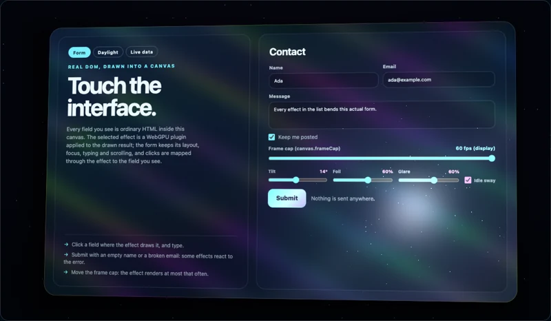

# holo-card

The HTML drawn in a canvas becomes a holographic collectible card that tilts towards the pointer, a finger or the device; clicks are mapped through the 3D perspective.

An **example** effect plugin of this library, not part of the polyfill: nothing in `src/` imports it, and the polyfill, the frame cap and the effects host work without it. The effects host and its plugins are extensions of this library, not part of the HTML-in-Canvas proposal; native implementations do not provide them ([details](../../docs/guides/EFFECTS-PLUGINS.md#extensions-not-the-standard)). Like the host, it is **experimental** ([STABILITY.md](../../docs/STABILITY.md)): its options, actions and look may change in any minor release.



Recorded in headless Chrome from the plugin gallery (`node plugins/holo-card/test/gallery.e2e.mjs --record`): the idle sway, the pointer circling over the card, the action `demo`.

## What it does

The card tilts towards the pointer in perspective, on a spring (it sways gently when the pointer is away). It is shaded as a glossy laminated slab lit by a small lamp that hangs in front of the pointer:

- the **glare** is the specular reflection of that lamp on the real card normal (Blinn-Phong: a broad sheen and a sharp, warmer core, scaled by Schlick's Fresnel), so it slides over the card as the card tilts;
- the **foil** is a thin film whose interference colour follows the viewing angle of each pixel (and a film thickness that varies over the card), crossed by diagonal diffraction bands; it is strongest on dark parts of the card, so text stays readable;
- **glitter flakes** have their own tilted normals and glint only when they mirror the lamp to the eye;
- the **bevelled rim** is iridescent and brighter on the side that faces the lamp;
- a star field sits at another depth and drifts against the print (parallax), and the card casts a soft shadow.

The print is supersampled (four rotated-grid taps per pixel), so text does not shimmer while the card moves, and the output is dithered, so the dark gradients do not band. The form stays usable: a click on the tilted picture reaches the element drawn there, and a click beside the card reaches nothing.

**Touch.** A finger on the card tilts it towards the finger while it rests or moves there, and the card springs back when the finger lifts. The listeners are passive and never call `preventDefault`: the card never claims the gesture, so the page keeps scrolling under the finger (Chrome and Safari keep delivering `touchmove` while they scroll), and taps reach the form through the mapper as usual. A drag that only tilts, without scrolling the page, would need the card to claim every gesture that starts on it: on a whole-surface effect that traps the page, which the plugin does not do.

**Device tilt** (option `motion`, off by default): the card follows the orientation of the device (`DeviceOrientationEvent`), measured from how the device is held (that reference follows the device over about 3 s, so the card recentres when you change your grip). On a touch device `mountUI` shows a "Tilt with device" checkbox; on iOS its tap asks for the motion permission (`DeviceOrientationEvent.requestPermission`). While it is on, the idle sway is off; sensor noise under a hundredth of the range wakes nothing.

## Usage

```html
<script src="dist/hic-live-polyfill.iife.min.js"></script>
<script src="dist/hic-live-effects.iife.min.js"></script>
<script src="dist/plugins/holo-card.iife.min.js"></script>   <!-- window.HicLivePlugins['holo-card'] -->
<script type="module">
  const host = await HTMLInCanvasEffects.createHost(canvas, form, { interposer: true });
  const card = await host.addPlugin(HicLivePlugins['holo-card'].plugin, { tilt: 14, foil: 0.6 });
  card.mountUI(document.getElementById('controls'));   // tilt, foil and glare sliders, "Idle sway" (and "Tilt with device" on touch devices)
  await card.trigger('demo');                           // a tilt sweep that shows the foil and the glare; resolves 'rest'
</script>
```

ES modules: `import { plugin } from '@giuseppe-scotto-lavina/html-in-canvas-polyfill/plugins/holo-card'`.

## Options

| option | default | |
|---|---|---|
| `tilt` | 14 | 0 to 30 degrees: the largest tilt, reached with the pointer on an edge of the canvas |
| `foil` | 0.6 | 0 to 1: iridescent foil, sparkles and rim (strongest on dark parts of the card, so text stays readable) |
| `glare` | 0.6 | 0 to 1: specular glare at the pointer and a sheen that sweeps with the tilt |
| `idle` | true | the card sways slowly while the pointer is away (declared `continuous`: see Performance) |
| `motion` | false | the card follows the device orientation (above); ignored with reduced motion |
| `scale` | 0.86 | 0.5 to 1: size of the card in the canvas, so that the tilted card stays inside |

`mountUI` adds tilt, foil and glare sliders, an "Idle sway" checkbox and, on a touch device with orientation sensors, a "Tilt with device" checkbox.

## Actions

`handle.trigger('demo')` ([semantics](../../docs/guides/EFFECTS-PLUGINS.md#5-actions-trigger-and-settled)); no options.

| action | | resolves with |
|---|---|---|
| `demo` | a 3.2 s tilt sweep along a figure eight, so the glare and the foil travel over the whole card, starting where the card is and landing on its rest pose without a jump | `'rest'` once the card has come to rest (with the idle sway on: half a second after the sweep); `null` when the pointer, a finger or a newer trigger takes over |

With reduced motion `demo` resolves `'rest'` at once (the card stays flat). `handle.settled()` resolves `'rest'` once nothing moves but the idle sway. The plugin never starts the demo by itself.

## Input

`mapCardPoint(state, point)` is the JavaScript twin of the projection in `holo-card.wgsl`: the eye is `2 x max(width, height)` CSS px in front of the canvas centre, the card plane passes through the centre with the rotated normal, and the point where the ray through the presented point meets the plane, expressed in the card's own axes and divided by the card scale, is the source point. The rotated axes are computed once per frame on the CPU (`writeCardPose`) and written into the uniform block, so the shader and the mapper use the very same numbers. A point beside the card (or in its rounded corners) maps to `NO_TARGET`: the host swallows a press there. Each presented frame's block is copied into one of four slots, so the card can keep moving without changing the mapper of an earlier frame; a pointer gesture gets a frozen copy. Foil, glare, sparkles and stars change colours only.

## Reduced motion

With `prefers-reduced-motion: reduce` the card stays flat (no tilt, no sway, no shimmer over time, no device tilt, and `demo` resolves at once); the glare still follows the pointer.

## Performance

GPU time, measured on 2026-11-04 (Apple M1 Max, headless Chrome, 2200 x 1240 target = the gallery canvas at DPR 2, 600 frames back to back): 0.37 ms per frame, against 0.06 ms for a pass that only clears the target (`measureGpuTime` of `plugins/_shared/gpu-time.mjs`; 0.21 ms before the lit shading). On the iPad Pro 11-inch (3rd generation, Safari, iPadOS 27.2, 120 Hz, frame cap 120), measured from `effectframe` events: the demo renders 120 frames per second with frame intervals of 8.32 ms (p50) and 8.54 ms (p95); with `idle: false` the card renders nothing at rest, before and after the demo (0 frames in 3 s).

The tilt follows the pointer on a spring that integrates `frame.delta` (the same timing at a 15 fps cap as at 120 fps). The instance is `continuous` only while the card moves (a pointer, a finger, the device, the demo, the spring settling). The idle sway alone is slow (at most about 5 degrees a second), so once the spring has caught up with it the plugin redraws it 30 times a second from a timer instead of at the display rate (`SWAY_HZ`; `meta.continuous` says so): on the iPad at 120 Hz the sway rendered 120 frames per second before and 30 now, at 33.4 ms intervals (p50 and p95). No allocation per frame (one uniform array, one render pass descriptor, bind groups cached per source view). After a device loss the host re-creates the plugin with its latest options.

## Limitations

- The space beside the tilted card takes no input (by design: it shows no element); the card is drawn at `scale` of the canvas.
- With `idle: true` the card sways, so the host renders 30 frames per second while the pointer is away. With `idle: false` it renders nothing at rest.
- A finger tilts the card only while the browser delivers touch events (it does while it scrolls); the plugin does not claim the gesture.
- Device tilt was tested with simulated orientation events, not on a real device in hand.
- WebGPU only (without an adapter `createHost` rejects with a `NotSupportedError`). Runs over the polyfill and over a browser's own HTML-in-Canvas implementation ([what differs there](../../docs/guides/EFFECTS-PLUGINS.md#on-a-native-implementation)); not run there by the test suites (the native suite runs water, CRT and disintegrate); expected to behave the same, as the plugin uses only the plugin interface.

## Files and tests

| file | |
|---|---|
| `index.js` | `meta`, `plugin`, `ACTIONS`, `mapCardPoint`, `writeCardPose`, `demoTarget`, `motionTarget`, `DEMO_MS`, `MOTION_RANGE`, `NO_TARGET` (re-exported from the effects ABI), `UNIFORM_FLOATS` |
| `holo-card.wgsl` | the shader; inlined into the built bundles |
| `wgsl.js` | loads the shader when the plugin runs from source; the build replaces it |
| `media/holo-card.webp` | the recording above |
| `test/holo-card.test.mjs` | Node: the folder contract, the mapper as the inverse of an independent forward projection, spring, idle sway, reduced motion, frame cap, no per-frame allocation, per-frame freeze of the mapper, the passive touch tilt (no `preventDefault`), the demo (sweep, landing, rest, interruption, reduced motion, through the real handle), the device tilt (axes per screen orientation, dead band, listener removal) |
| `test/holo-card-gpu.browser.test.mjs` | headless Chrome: the mapper against the GPU pixels (`checkMapperAgainstGpu`, with the identity mapper as the control), the flat card as a second control, a card tilting on its spring, the demo through the real host (every checked frame against its mapper), device loss, GPU time |
| `test/gallery.e2e.mjs` | headless Chrome, trusted input, in the plugin gallery: rests the pointer where the tilted card draws a control away from its DOM position and clicks; console errors, frame rate and reduced motion; then with touch emulation a finger drag that tilts the card while the page scrolls (control: the same drag with the gesture claimed scrolls nothing), the action `demo`, zero frames at rest. `--record` writes the media (`npm run build` first) |
