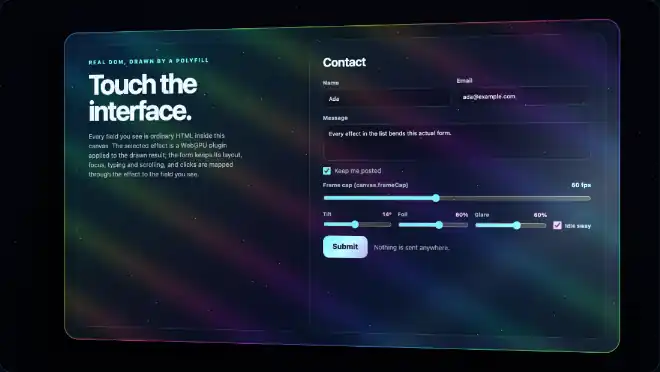

# holo-card

The HTML drawn in a canvas becomes a holographic collectible card that tilts towards the pointer; clicks are mapped through the 3D perspective.

An **example** effect plugin of this library, not part of the polyfill: nothing in `src/` imports it, and the polyfill, the frame cap and the effects host work without it. The effects host and its plugins are extensions of this library, not part of the HTML-in-Canvas proposal; native implementations do not provide them ([details](../../docs/guides/EFFECTS-PLUGINS.md#extensions-not-the-standard)).



Recorded in headless Chrome from the plugin gallery.

## What it does

The card tilts towards the pointer in perspective, on a spring (it sways gently when the pointer is away). An iridescent foil shifts its colours with the viewing angle, sparkles and a star field sit at other depths and move against the print (parallax), and a specular glare follows the pointer. The form stays usable: a click on the tilted picture reaches the element drawn there, and a click beside the card reaches nothing.

## Usage

```html
<script src="dist/hic-live-polyfill.iife.min.js"></script>
<script src="dist/hic-live-effects.iife.min.js"></script>
<script src="dist/plugins/holo-card.iife.min.js"></script>   <!-- window.HicLivePlugins['holo-card'] -->
<script>
  const host = await HTMLInCanvasEffects.createHost(canvas, form, { interposer: true });
  const card = await host.addPlugin(HicLivePlugins['holo-card'].plugin, { tilt: 14, foil: 0.6 });
  card.mountUI(document.getElementById('controls'));   // tilt, foil and glare sliders and an "Idle sway" checkbox
</script>
```

ES modules: `import { plugin } from '@giuseppe-scotto-lavina/html-in-canvas-polyfill/plugins/holo-card'`.

## Options

| option | default | |
|---|---|---|
| `tilt` | 14 | 0 to 30 degrees: the largest tilt, reached with the pointer on an edge of the canvas |
| `foil` | 0.6 | 0 to 1: iridescent foil, sparkles and rim (strongest on dark parts of the card, so text stays readable) |
| `glare` | 0.6 | 0 to 1: specular glare at the pointer and a sheen that sweeps with the tilt |
| `idle` | true | the card sways slowly while the pointer is away |
| `scale` | 0.86 | 0.5 to 1: size of the card in the canvas, so that the tilted card stays inside |

`mountUI` adds tilt, foil and glare sliders and an "Idle sway" checkbox.

## Actions

None: the card follows the pointer. `handle.actions` is empty, and `handle.trigger(...)` / `handle.settled()` reject with a `TypeError` ("declares no actions").

## Input

`mapCardPoint(state, point)` is the JavaScript twin of the projection in `holo-card.wgsl`: the eye is `2 x max(width, height)` CSS px in front of the canvas centre, the card plane passes through the centre with the rotated normal, and the point where the ray through the presented point meets the plane, expressed in the card's own axes and divided by the card scale, is the source point. The rotated axes are computed once per frame on the CPU (`writeCardPose`) and written into the uniform block, so the shader and the mapper use the very same numbers. A point beside the card (or in its rounded corners) maps to `NO_TARGET`: the host swallows a press there. Each presented frame's block is copied into one of four slots, so the card can keep moving without changing the mapper of an earlier frame; a pointer gesture gets a frozen copy. Foil, glare, sparkles and stars change colours only.

## Reduced motion

With `prefers-reduced-motion: reduce` the card stays flat (no tilt, no sway, no shimmer over time); the glare still follows the pointer.

## Performance

GPU time, measured on 2026-10-14 (Apple M1 Max, headless Chrome, 2200 x 1240 target = the gallery canvas at DPR 2, 600 frames back to back): 0.21 ms per frame, against 0.06 ms for a pass that only clears the target (`measureGpuTime` of `plugins/_shared/gpu-time.mjs`). The tilt follows the pointer on a spring that integrates `frame.delta` (the same timing at a 15 fps cap as at 120 fps); the instance is `continuous` only while the card moves or sways, and at rest the host renders nothing. No allocation per frame (one uniform array, one render pass descriptor, bind groups cached per source view). After a device loss the host re-creates the plugin with its latest options.

## Limitations

- The space beside the tilted card takes no input (by design: it shows no element); the card is drawn at `scale` of the canvas.
- With `idle: true` the card sways, so the host renders at the frame cap while the pointer is away.
- WebGPU only, and only while the polyfill provides the API (not over a native implementation).

## Files and tests

| file | |
|---|---|
| `index.js` | `meta`, `plugin`, `mapCardPoint`, `writeCardPose`, `NO_TARGET` (re-exported from the effects ABI), `UNIFORM_FLOATS` |
| `holo-card.wgsl` | the shader; inlined into the built bundles |
| `wgsl.js` | loads the shader when the plugin runs from source; the build replaces it |
| `media/holo-card.webp` | the recording above |
| `test/holo-card.test.mjs` | Node: the folder contract, the mapper as the inverse of an independent forward projection, spring, idle sway, reduced motion, frame cap, no per-frame allocation, per-frame freeze of the mapper |
| `test/holo-card-gpu.browser.test.mjs` | headless Chrome: the mapper against the GPU pixels (`checkMapperAgainstGpu`, with the identity mapper as the control), the flat card as a second control, a card tilting on its spring, device loss, GPU time |
| `test/gallery.e2e.mjs` | headless Chrome, trusted input, in the plugin gallery: rests the pointer where the tilted card draws a control away from its DOM position and clicks; also console errors, frame rate and reduced motion (`npm run build` first) |
