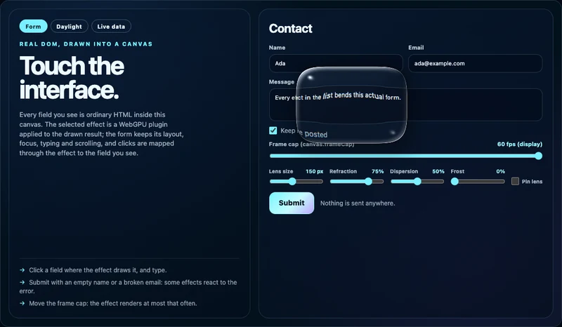

# liquid-glass

A slab of refractive glass over the HTML drawn in a canvas: a finger drags it, a mouse or a pen leads it on a spring (or it stays pinned), and a click or a tap through the glass reaches the element the glass shows there.

An **example** effect plugin of this library, not part of the polyfill: nothing in `src/` imports it, and the polyfill, the frame cap and the effects host work without it. The effects host and its plugins are extensions of this library, not part of the HTML-in-Canvas proposal; native implementations do not provide them ([details](../../docs/guides/EFFECTS-PLUGINS.md#extensions-not-the-standard)).



Recorded in headless Chrome from the plugin gallery (`node plugins/liquid-glass/test/gallery.e2e.mjs --record`): the `demo` action.

## What it does

The glass is a convex slab with a superellipse outline: each corner is a quarter of `|x|^4 + |y|^4 = r^4` (a squircle when the slab is as wide as it is high). Its surface is a height field, not a distortion map: a gentle dome over the whole slab (it magnifies the middle), faded in from the edge, and a tall elliptic bevel that turns vertical at the edge, where the glass is 0 thick. For every pixel the plugin takes the real surface normal of that field, refracts the view ray by Snell's law (index 1.5), and follows it through the glass thickness down to the page. The result:

- the middle is magnified a little (1.05x at the default refraction, 1.08x at the most, for the default 1.45 aspect; 1.10x and 1.20x for a round slab), and sampled with a Catmull-Rom filter, so the magnified text stays as crisp as the page at device resolution;
- the rim bends the rays inward: it shows what lies under it compressed into a narrow band (its first 8 CSS px show about 17 px of the page), the lensing of a glass edge. The glass is 0 thick at the edge, so the picture is continuous across it, and the profile is chosen so that it never folds: every point of the page under the glass is shown exactly once, for every aspect and refraction (a Node test checks it), so nothing is hidden or doubled;
- dispersion: red and blue are refracted with their own indices (down to 1.4 and up to 1.6 at `dispersion` 1; two samples each across their band), so fringes appear only where the glass bends light, strongest on the rim, never as a flat RGB offset;
- Fresnel reflection (Schlick, F0 = 0.04): the surface reflects a soft studio light, more and more towards grazing angles on the rim;
- specular light from a low key light at the upper left and a weaker rim light opposite: sharp glints, the light caught along the steep part of the rim, and a thin bright edge;
- a soft drop shadow cast away from the light, a contact shadow at the edge and an inner shadow along the rim;
- an optional frost (`frost`): a 12-tap golden-angle blur rotated per pixel;
- analytic anti-aliasing of the edge over 2/3 of a backing pixel, and dithering where gradients are smooth, so the shadows and the glass do not band.

The page under it stays live and usable: what the glass shows is updated with the page (typing, the caret, focus rings), and a click or a tap through the glass reaches the element the glass shows there, not the one under the pointer in the DOM.

## Interaction

- **Mouse and pen:** the glass follows the pointer on a spring, as a hover magnifier. Nothing has to be grabbed, and a click lands where the middle of the glass shows (the least bent part). Leaving the canvas sends it back to its rest position (`x`, `y`).
- **The springs** are one constant per pointer kind, `SPRINGS` in `index.js` (exported): `mouse` (a mouse or a pen, and the demo) has a stiffness of 600 /s² and a damping ratio of 0.74, `finger` 1300 /s² and 0.9. The jelly stretch keeps its ratio to the mouse spring (its stiffness is 420 / 260 of the mouse's), so it wobbles as it did. Measured on the plugin at 120 Hz along a fast path over the gallery's 1038 x 640 stage (pointer speed 2,200 px/s at the median, 3,200 at most): a mouse leaves the glass 55 ms behind it at the median and 62 ms at p95 (120 and 167 px), a finger 43 and 52 ms (94 and 131 px); a mouse jump of 300 px overshoots by 6.8 px and settles in 0.93 s, a finger never overshoots. Before 2026-11-05 the springs were 260 and 900 /s²: 89 / 104 ms (186 / 262 px) behind a mouse, 53 / 65 ms behind a finger.
- **Touch:** a finger that lands on the glass (or within 10 CSS px of it) drags it: the glass swells a little under the finger, follows it on a stiff spring, stretches along its velocity like a drop and wobbles once when it stops; a flick carries it on, then a spring brings it to rest. The gesture is claimed only for such a finger, at its first `touchmove` (`preventDefault` on a non-passive listener), so the page does not scroll while the glass is dragged. A touch anywhere else is never prevented: the page scrolls and the form works as usual. A tap on the glass is not claimed either, so it stays a native tap (focus, caret, the on-screen keyboard, click) that the host maps through the glass. The touchstart itself is not prevented for that reason: preventing it would also cancel the tap.
- A pinned glass (`pinned: true`) does not move with the pointer or a finger.
- `meta.touch` is the one-line hint a page can show on touch screens: "Drag the glass with a finger; tap through it to use the form."

## Usage

```html
<script src="dist/hic-live-polyfill.iife.min.js"></script>
<script src="dist/hic-live-effects.iife.min.js"></script>
<script src="dist/plugins/liquid-glass.iife.min.js"></script>   <!-- window.HicLivePlugins['liquid-glass'] -->
<script type="module">
  const host = await HTMLInCanvasEffects.createHost(canvas, form, { interposer: true });
  const glass = await host.addPlugin(HicLivePlugins['liquid-glass'].plugin, { size: 150, refraction: 0.75 });
  glass.mountUI(document.getElementById('controls'));   // size, refraction, dispersion and frost sliders and a "Pin lens" checkbox
  await glass.trigger('demo');                          // a short tour over the page; resolves 'free' at rest
  glass.setOptions({ pinned: true, x: 0.3, y: 0.5 });   // park the glass over a part of the form
</script>
```

ES modules: `import { plugin } from '@giuseppe-scotto-lavina/html-in-canvas-polyfill/plugins/liquid-glass'`.

## Options

| option | default | |
|---|---|---|
| `size` | 150 | 60 to 280 CSS px: height of the slab; its width is `size * aspect` |
| `aspect` | 1.45 | 1 to 2.5: width / height (1 is a squircle) |
| `refraction` | 0.75 | 0 to 1: curvature of the surface (the dome and the bevel); 0 is a flat slab, which bends nothing |
| `dispersion` | 0.5 | 0 to 1: how far the red and blue indices are from green's (up to 0.1) |
| `frost` | 0 | 0 to 1: blur of what the glass shows (radius up to 0.09 of the slab's half height) |
| `highlight` | 1 | 0 to 1: specular light and Fresnel reflection |
| `shadow` | 1 | 0 to 1: drop, contact and inner shadow |
| `pinned` | false | the glass stays at (`x`, `y`) instead of following the pointer or a finger |
| `x`, `y` | 0.73, 0.3 | 0 to 1, a fraction of the canvas: where the glass rests (its start position, where it returns when the pointer leaves the canvas, and where it is pinned) |

`mountUI` adds size, refraction, dispersion and frost sliders and a "Pin lens" checkbox (it pins the glass where it is at that moment: it sets `pinned`, `x` and `y`).

## Actions

| action | what it does | resolves with |
|---|---|---|
| `demo` | the glass glides over up to four places of the drawn page, then comes back to where it rests. The places are found in the drawn HTML itself (fields first, then headings, buttons and text, far from each other; without any, a fixed tour), so it works on any page. 3.2 s of tour plus the settling of the spring, under 4 s in all. Any pointer move, a press, a finger on the glass or `setOptions` takes over at once (the trigger then resolves `null`). With reduced motion it resolves at once and nothing moves. | `'free'`, or `'pinned'` for a pinned glass |

`handle.settled()` resolves with the same state once nothing moves. The plugin never starts the demo by itself; a page triggers it (the plugin gallery does when the effect is selected).

## Input

`mapLensPoint(state, point)` is the JavaScript twin of the sampling in `liquid-glass.wgsl`: the same superellipse distance (`sdSquircle`), the same height field and normal (`lensSurface`), the same refraction through the thickness (`bendThrough`), the same clamp. It returns where the green channel samples; dispersion only spreads red and blue around it. The plugin copies the uniform block of every presented frame into one of four slots and the mapper of that frame reads its slot, so a later frame (the glass keeps moving on its springs) does not change an earlier mapper; a pointer gesture gets a frozen copy. Outside the glass (where its anti-aliased edge has a coverage of 0.5 and less) the mapping is the identity.

## Reduced motion

With `prefers-reduced-motion: reduce` the glass jumps to the pointer or the finger (no spring, no inertia, no stretch, no swell) and the demo resolves at once, so nothing animates.

## Performance

GPU time, measured on 2026-11-04 (Apple M1 Max, headless Chrome, 2200 x 1240 target = the gallery canvas at DPR 2, 600 frames back to back): 0.14 ms per frame, against 0.06 ms for a pass that only clears the target (`measureGpuTime` of `plugins/_shared/gpu-time.mjs`). One pass; the expensive part (up to 25 texture reads for the Catmull-Rom samples of three channels, 60 with frost) runs only under the glass. The springs integrate `frame.delta`, so the glass takes the same time at a 15 fps cap as at 120 fps. Zero work at rest: once the glass, its stretch and its swell have settled, the instance is not `continuous` and the host renders nothing (no effectframe) until the pointer, a finger, an option or the page changes. No allocation per frame. After a device loss the host re-creates the plugin with its latest options (including a pinned position).

## Limitations

- A finger that starts on the glass and moves drags it, even over a control; to use a control under the glass with a finger, tap it.
- Dispersion moves red and blue only; the green channel is the one the mapper describes, so a click on a red or blue fringe goes where green shows.
- WebGPU only (without an adapter `createHost` rejects with a `NotSupportedError`). Runs over the polyfill and over a browser's own HTML-in-Canvas implementation ([what differs there](../../docs/guides/EFFECTS-PLUGINS.md#on-a-native-implementation)); not run there by the test suites (the native suite runs water, CRT and disintegrate); expected to behave the same, as the plugin uses only the plugin interface.

## Files and tests

| file | |
|---|---|
| `index.js` | `meta`, `plugin`, `GLASS`, `mapLensPoint`, `lensSurface`, `bendThrough`, `sdSquircle`, `writeLensGeometry`, `demoStops`, `tourPoint`, `UNIFORM_FLOATS` |
| `liquid-glass.wgsl` | the shader; inlined into the built bundles |
| `wgsl.js` | loads the shader when the plugin runs from source; the build replaces it |
| `media/liquid-glass.webp` | the recording above |
| `test/liquid-glass.test.mjs` | Node: the folder contract; the mapper against an independent formula (the height field differentiated numerically, Snell's law by angles) on dense grids for moved, round, stretched and pressed lenses; magnification, the rim, continuity at the edge and the critical angle; no fold for aspects 1 to 2.5; the spring, the stretch, pinning, reduced motion, the frame cap; touch (the claim only on the glass and only at a move, the grab offset, the flick, a pinned glass); the demo (its places, its length, its end at home, the take-over); zero work at rest; no per-frame allocation; the per-frame freeze of the mapper |
| `test/liquid-glass-gpu.browser.test.mjs` | headless Chrome: the mapper against the GPU pixels (`checkMapperAgainstGpu`, with the identity mapper as the control), a lens 12 px off as a second control, dispersion, a moving lens, device loss, the demo on the GPU (every checked frame mapped, back home), frost only under the glass, GPU time |
| `test/gallery.e2e.mjs` | headless Chrome, trusted input, in the plugin gallery: pins the lens next to a control and clicks where the lens draws it; with touch emulation, a drag off the glass scrolls the page and leaves the glass, a drag on the glass moves it without scrolling, a tap on the glass focuses the field it shows; the demo and zero effectframes at rest after load, after a drag and after the demo; console errors, frame rate and reduced motion (`npm run build` first) |
