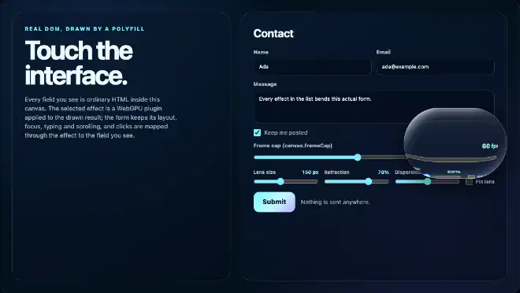

# liquid-glass

A refractive glass lens over the HTML drawn in a canvas: it follows the pointer on a spring (or stays pinned), and a click through the lens reaches the element the lens shows there.

An **example** effect plugin of this library, not part of the polyfill: nothing in `src/` imports it, and the polyfill, the frame cap and the effects host work without it. The effects host and its plugins are extensions of this library, not part of the HTML-in-Canvas proposal; native implementations do not provide them ([details](../../docs/guides/EFFECTS-PLUGINS.md#extensions-not-the-standard)).



Recorded in headless Chrome from the plugin gallery.

## What it does

The lens magnifies what is under its flat centre, bends the picture from just outside the lens into its curved rim, splits red and blue a little on the rim (chromatic dispersion), and has a specular highlight and a soft shadow. The form under the lens stays usable: a click through the lens reaches the element the lens shows there, not the one that is under the pointer in the DOM.

## Usage

```html
<script src="dist/hic-live-polyfill.iife.min.js"></script>
<script src="dist/hic-live-effects.iife.min.js"></script>
<script src="dist/plugins/liquid-glass.iife.min.js"></script>   <!-- window.HicLivePlugins['liquid-glass'] -->
<script>
  const host = await HTMLInCanvasEffects.createHost(canvas, form, { interposer: true });
  const lens = await host.addPlugin(HicLivePlugins['liquid-glass'].plugin, { size: 150, refraction: 0.7 });
  lens.mountUI(document.getElementById('controls'));   // size, refraction, dispersion sliders and a "Pin lens" checkbox
  lens.setOptions({ pinned: true, x: 0.3, y: 0.5 });   // park the lens over a part of the form
</script>
```

ES modules: `import { plugin } from '@giuseppe-scotto-lavina/html-in-canvas-polyfill/plugins/liquid-glass'`.

## Options

| option | default | |
|---|---|---|
| `size` | 150 | 60 to 280 CSS px: height of the lens; its width is `size * aspect` |
| `aspect` | 1.45 | 1 to 2.5: width / height (1 is a round lens, more is a pill) |
| `refraction` | 0.7 | 0 to 1: magnification of the centre (up to 1.28x) and bending of the rim; 0 is flat glass |
| `dispersion` | 0.5 | 0 to 1: red / blue fringes on the rim (up to 6 CSS px) |
| `highlight` | 1 | 0 to 1: specular highlight and sheen |
| `pinned` | false | the lens stays at (`x`, `y`) instead of following the pointer |
| `x`, `y` | 0.73, 0.3 | 0 to 1, a fraction of the canvas: where the lens rests (its start position, where it returns when the pointer leaves the canvas, and where it is pinned) |

`mountUI` adds size, refraction and dispersion sliders and a "Pin lens" checkbox (it pins the lens where it is at that moment: it sets `pinned`, `x` and `y`).

## Actions

None: the lens follows the pointer or `setOptions`. `handle.actions` is empty, and `handle.trigger(...)` / `handle.settled()` reject with a `TypeError` ("declares no actions").

## Input

`mapLensPoint(state, point)` is the JavaScript twin of the sampling in `liquid-glass.wgsl`: the same rounded-box distance, the same outward normal, the same edge profile `(1 - t)^2` and the same clamp. The plugin copies the uniform block of every presented frame into one of four slots and the mapper of that frame reads its slot, so a later frame (the lens keeps moving on its spring) does not change an earlier mapper; a pointer gesture gets a frozen copy. Outside the lens the mapping is the identity.

## Reduced motion

With `prefers-reduced-motion: reduce` the lens jumps to the pointer (no spring, no stretch), so nothing animates.

## Performance

GPU time, measured on 2026-10-14 (Apple M1 Max, headless Chrome, 2200 x 1240 target = the gallery canvas at DPR 2, 600 frames back to back): 0.09 ms per frame, against 0.06 ms for a pass that only clears the target (`measureGpuTime` of `plugins/_shared/gpu-time.mjs`). The spring integrates `frame.delta`, so the lens takes the same time at a 15 fps cap as at 120 fps; while the lens is at rest the instance is not `continuous` and the host renders nothing (a pointer move wakes it). No allocation per frame. After a device loss the host re-creates the plugin with its latest options (including a pinned position).

## Limitations

- Dispersion moves red and blue only; the green channel is the one the mapper describes, so a click on a red or blue fringe goes where green shows.
- WebGPU only (without an adapter `createHost` rejects with a `NotSupportedError`). Runs over the polyfill and over a browser's own HTML-in-Canvas implementation ([what differs there](../../docs/guides/EFFECTS-PLUGINS.md#on-a-native-implementation)); not run there by the test suites (the native suite runs water, CRT and disintegrate); expected to behave the same, as the plugin uses only the plugin interface.

## Files and tests

| file | |
|---|---|
| `index.js` | `meta`, `plugin`, `mapLensPoint`, `writeLensGeometry`, `sdBox`, `UNIFORM_FLOATS` |
| `liquid-glass.wgsl` | the shader; inlined into the built bundles |
| `wgsl.js` | loads the shader when the plugin runs from source; the build replaces it |
| `media/liquid-glass.webp` | the recording above |
| `test/liquid-glass.test.mjs` | Node: the folder contract, the mapper against an independent formula, spring, pinning, reduced motion, frame cap, no per-frame allocation, per-frame freeze of the mapper |
| `test/liquid-glass-gpu.browser.test.mjs` | headless Chrome: the mapper against the GPU pixels (`checkMapperAgainstGpu`, with the identity mapper as the control), a lens 12 px off as a second control, dispersion, a moving lens, device loss, GPU time |
| `test/gallery.e2e.mjs` | headless Chrome, trusted input, in the plugin gallery: pins the lens next to a control and clicks where the lens draws it; also console errors, frame rate and reduced motion (`npm run build` first) |
