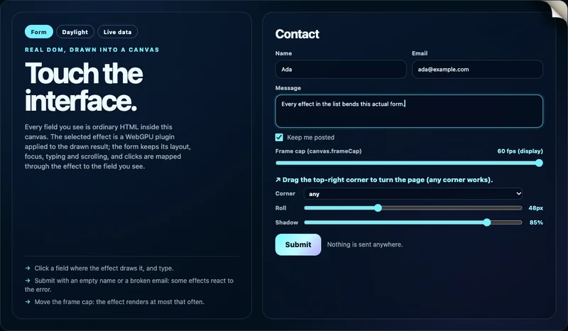

# page-curl

The HTML drawn in a canvas becomes a sheet of paper you can take by a corner and turn: grab a corner and the live page folds and rolls up under your hand in 3D, lit and shadowed, still updating; it springs back on release.

An **example** effect plugin of this library, not part of the polyfill: nothing in `src/` imports it, and the polyfill, the frame cap and the effects host work without it. The effects host and its plugins are extensions of this library, not part of the HTML-in-Canvas proposal; native implementations do not provide them ([details](../../docs/guides/EFFECTS-PLUGINS.md#extensions-not-the-standard)). Like the host, it is **experimental** ([STABILITY.md](../../docs/STABILITY.md)): its options, actions and look may change in any minor release.



Recorded in headless Chrome from the plugin gallery (`node plugins/page-curl/test/gallery.e2e.mjs --record`).

## What it does

It applies to any drawable, with no change to the HTML.

- **A 3D sheet that rolls on a cone.** The page is folded along a straight line and rolled under the held corner: the part between the bound edge and the fold stays flat, the roll lifts, the part beyond it lies back side up, with the held corner exactly under the pointer. The sheet is bound along the edge opposite the corner. Paper held by a corner does not roll with one radius along the whole fold: the roll is a cone (the developable deformation of e-book page turns, Hong, Card and Chen, IEEE 3DUI 2006) that keeps the roll's radius by the held corner and narrows towards the far end of the fold, as much as the corner is off the middle of the fold (to 0.3 of it at most): a page turned by its top corner rolls wide at the top and tight at the bottom. The part beyond the roll lies on the plane that touches the cone, so it rises away from the cone's apex. When the corner's foot is in the middle of the fold the cone is a cylinder. Wrapping a sheet round a cone or a cylinder never stretches it, so the paper keeps its proportions (the tests measure it). A long pull bows the sheet into a larger loop.
- **Seen and lit.** A camera straight above the page with a little perspective. The light is the room's (from the dome above the page: a surface turned edge-on sees half of it, one facing down none) plus a lamp high above the top-right corner at a finite distance. Every part of the sheet is lit by its real surface normal, so the roll reads as round: on a roll of the top-right corner the back of the paper runs from the flap into a highlight band where it mirrors the lamp, then falls off, darker, towards the rolled edge (on the gallery's form, across the roll: about 217, 248, then 157 of 255). The crease, where the page and the roll close in on each other, is dark, and so is the inside of the tube where it shows (past a short flap, or at the roll's open end; softened so that the live content on it stays readable). Where the front faces the lamp, warm light comes through the thin paper on its back, the ink of the front darker in it. The flat part of the page keeps exactly its own pixels.
- **Paper.** The back of the sheet and the page underneath have a relief (long fibres and a finer tooth) that the lamp picks out, and a faint cloudiness; the cut edge of the lifted paper shows its thickness (a darker cut face and a lit lip). Everything the effect lights or shades is dithered (half a level of 8 bits), so smooth gradients of light and shadow do not band.
- **Shadows.** The roll occludes the page beneath it: dark right at its edge and fading within about two radii (the occlusion of a cylinder lying on the page, from the paper's contact), so a larger, higher roll occludes wider (on the gallery's form: 86 of 255 at the edge, back to 191). The lifted paper also casts the lamp's shadow on the page underneath and on the flat part of the sheet, its penumbra widening with the height of the paper (sharp where the roll meets the page, soft under the raised flap). Shadowed paper is lit by the cool light of the room, not the warm lamp.
- **The back of the sheet is paper**, with the page's content showing through it, diffused and mirrored, as ink shows through real paper (the fibres scatter it: a 9-tap blur of about 1 CSS px and a soft response, never a crisp copy of the front); the show-through follows the light, plain where the paper is lit and fading in its shade.
- **Live.** The sheet samples the live page every frame: typing into a field while the page is held curled shows the text on the curling sheet; the flat part stays usable at any time.
- **Physics-like follow.** The corner follows the pointer on a spring and springs back when released. The springs run in fixed steps on the frame clock, so a pose depends on the time only, at any frame cap (the demo's hand too).
- **Affordances.** At rest one corner (`corner`, else top-right) is a small dog-ear. It opens once on demand with the action `peek`, and the action `demo` turns the page; with `autoPeek` set it also peeks open by itself every `autoPeek` seconds until the first drag (off by default). Hovering a corner lifts it further with a `grab` cursor (`grabbing` while dragging). The plugin's controls show the hint "Drag the top-right corner to turn the page (any corner works)".
- **Zero work at rest.** Once the sheet lies still nothing is drawn: no effect frame, no animation frame, no timer (with the default `autoPeek: 0`), until the page changes, a pointer comes near a corner or an action runs.
- **The page underneath** is plain paper, faintly ruled (`under`). On a host with an under page (`createHost(canvas, source, {under})`, experimental, [guide](../../docs/guides/EFFECTS-PLUGINS.md#122-the-under-page-contextunder)) it is that second live page instead: its own pixels where nothing shades it, darkened by the same roll occlusion and lamp shadow as the paper (to a quarter at most, so it stays readable), dithered only where it is shaded. It is usable where the sheet uncovers it: the mapper sends the pointer there (`under: true`), a click focuses its field and typing shows up in it. The under page is drawn in the dog-ear at rest too, but it is usable only once the sheet is lifted away from its rest pose: the plugin reports `revealsUnder` then, and the host keeps the under page `inert` otherwise (a field of it that has the focus when the sheet falls back is blurred). A press on the uncovered under page keeps the sheet where it is (`settled()` resolves `'open'`): the press itself reaches the under page, and typing shows up there; a press anywhere else, or Escape, lets the sheet spring back.

**Extended range.** On a host with `hdr: true` ([guide](../../docs/guides/EFFECTS-PLUGINS.md#121-extended-range-contexthdr)) the page, the paper and their diffuse light (room, lamp, the light through the sheet) stay under white. The lamp's mirror highlight goes above it, modestly, as paper is not a mirror: a band about 10 px wide along the roll (the top fifth of the sheen's lobe, exactly 0 beside it), on the back of the sheet where it reflects the lamp to the eye (broken up by the relief of the paper) and on the front where it turns over. It rises as the corner leaves its rest pose (in full 42 CSS px away from it), so the dog-ear at rest and the flat page show nothing above white. Measured in the plugin gallery (canvas 1100 x 640 at device pixel ratio 1, headless Chrome, a probe stage after the plugin; the demo, a pointer sweep and a click): the dog-ear at rest: nothing above white; on the form scene at most 87 px above white in a frame (0.01 % of the canvas, 0 of them above 1.4), largest value 1.32; on the daylight scene at most 87 px above white in a frame (0.01 % of the canvas, 0 of them above 1.4), largest value 1.32. Before the plugin told the page from the light, the same run gave 118 px (up to 1.19) on the form and 100 px (up to 1.19) on the daylight scene. On a standard target the picture is the one it always was, bit for bit.

## Usage

```html
<script src="dist/hic-live-polyfill.iife.min.js"></script>
<script src="dist/hic-live-effects.iife.min.js"></script>
<script src="dist/plugins/page-curl.iife.min.js"></script>   <!-- window.HicLivePlugins['page-curl'] -->
<script type="module">
  const host = await HTMLInCanvasEffects.createHost(canvas, form, { interposer: true });
  const curl = await host.addPlugin(HicLivePlugins['page-curl'].plugin, { corner: 'any', radius: 48 });
  curl.mountUI(document.getElementById('controls'));   // the hint label, corner, roll and shadow controls
  helpButton.addEventListener('click', () => curl.trigger('peek'));   // show again that the page can be turned
  showButton.addEventListener('click', () => curl.trigger('demo'));   // turn the page once, to show the effect
</script>
```

ES modules: `import { plugin } from '@giuseppe-scotto-lavina/html-in-canvas-polyfill/plugins/page-curl'`.

## Options

| option | default | |
|---|---|---|
| `corner` | `'any'` | `'any'`, `'tl'`, `'tr'`, `'bl'`, `'br'`: which corners can be grabbed |
| `radius` | 48 | 4 to 200 CSS px (slider 12 to 120): the roll radius by the held corner; a long pull bows it up to 1.9 times larger, a short pull uses a tighter one (at most pull / pi); the cone narrows it towards the far end of the fold |
| `shadow` | 0.85 | 0 to 1: strength of the shadows |
| `dogEar` | 36 | 0 to 120 CSS px: how far the dog-eared corner is folded at rest (per axis); 0: no dog-ear |
| `autoPeek` | 0 | 0 to 600 seconds between the dog-ear's peeks until the first drag; 0 or `false`: off. Opt-in: a periodic animation is work at rest |
| `hotZone` | 64 | 16 to 200 CSS px: grab distance from a corner |
| `under` | `#d1c9bb` | the page underneath (`'#rrggbb'`) |
| `paper` | `#f6f2e9` | the back of the sheet (`'#rrggbb'`) |
| `underPage` | `true` | on a host with an under page: show it beneath the sheet; `false` shows the paper colour `under` there, as on a host without one |

`mountUI` adds the hint label, a corner picker and sliders for the roll and the shadow.

## Actions

`handle.trigger('peek')`, `handle.trigger('demo')` ([semantics](../../docs/guides/EFFECTS-PLUGINS.md#5-actions-trigger-and-settled)); no options. The plugin never starts either by itself.

| action | | resolves with |
|---|---|---|
| `peek` | the dog-eared corner opens and closes once now (1.8 s, the motion of the auto-peek), also after the first drag stopped the auto-peek | `'rest'`, once the sheet lies still again |
| `demo` | a hand takes the dog-eared corner, sweeps it along an arc most of the way to the bound edge (the page turns over, the page underneath shows) and lets go at 2 s; the sheet springs back to the dog-ear (about 2.9 s in all). A press on the page, a key, or a grab of a corner takes over at once: the hand lets go (a grabbed corner stays in the user's hand), and the press itself still reaches the page | `'rest'`, once the sheet lies still again |

`handle.settled()` resolves with `'rest'` once nothing moves (no drag, no spring, no peek, no demo). While a corner is held or springs back, or the demo plays, an action starts nothing and resolves at the next rest; a newer trigger resolves a pending one with `null`.

## Input

The grab is the plugin's own gesture. Its pointer events are taken in the capture phase at the document, before the host's interposer and the form see them: `preventDefault` (no focus change, no text selection, no compatibility mouse events), `stopImmediatePropagation`, the pointer is captured to the live layer, and the click that follows the release is swallowed. The form never sees the drag; keyboard input still reaches the focused field.

**Touch.** A finger that lands in a corner's hot zone claims its touch: the plugin listens to `touchstart` on the canvas and the live layer (`context.listen`, not passive) and prevents it, so the browser neither scrolls the page nor sends `pointercancel`; the pointer events of that finger then turn the page as a mouse does. A touch anywhere else, and a second finger (a pinch), are left to the page: it scrolls and zooms as usual, and taps reach the form through the mapper. No `touch-action` is needed on the drawable.

Every other pointer goes through the host's interposer and this plugin's input mapper, `mapCurlPoint(state, point)`, the twin of what the shader draws, with the same camera:

| presented pixel shows | mapper returns |
|---|---|
| the flat part of the page | the same point (identity) |
| the front of the roll, where it faces the reader | the exact page point it shows (the line of sight is intersected with the cone, a quadratic written relative to the fold line so that a far apex stays exact, or with the cylinder; the nearest crossing inside the sheet is the one seen) |
| the back of the sheet (the roll, the folded flap, the dog-ear) | `NO_TARGET` |
| the page underneath | `NO_TARGET`; on a host with an under page (and `underPage` on), the same point with `under: true`: the point of the under page |

`NO_TARGET` is the effects ABI value for "no element here" (re-exported by this plugin): the host swallows a press there and the mapper chain stops at it. `{x, y, under: true}` ends the chain too: the host hit-tests the point inside the under page.

## Reduced motion

With `prefers-reduced-motion: reduce`: the drag still curls the page (it follows the hand, without the spring's lag); the dog-ear stays still (no auto-peek; `peek` and `demo` move nothing and resolve `'rest'` at once); the release lays the page back at once and the hover lift appears without animation.

## Performance

`test/page-curl-gpu.browser.test.mjs`, headless Chrome 156 on an Apple M1 Max (Metal), 2200x1240 backing pixels (the gallery canvas at DPR 2), the page curled, while other work ran on the machine (2026-11-05, the cone): 1.31 ms per frame submitted back to back (the one-sample template pass: 0.08 ms), 16 % of the 8.33 ms frame at 120 Hz (1.34 ms with the cylinder of 2026-11-04; 0.81 ms before the lit paper of 2026-11: its light, relief and occlusion cost about 0.5 ms). One run on one machine. On the CPU the pose costs about 5 µs per frame (the Newton solve that keeps the corner under the hand on a cone).

On the physical iPad (iPad Pro 11-inch, 3rd generation, iPadOS 27.2, Safari, 120 Hz, DPR 2, the gallery at frame cap 120, 2026-11-05, the cone): during the action `demo` 119.5 and 119.8 effect frames per second, frame interval p50 8.34 ms and p95 8.6 ms (the second and third run; the first includes the measuring script's own screenshot); 0 effect frames in 3 s at rest, before and after it. The same as the cylinder of 2026-11-04. One run on one device.

Over a live under page the page underneath is one texture read and the shadow terms per pixel, in place of the paper's grain, rules and relief; the GPU time above is measured over the paper. The second page costs the host a snapshot and an upload when it changes ([guide](../../docs/guides/EFFECTS-PLUGINS.md#122-the-under-page-contextunder): about 11 ms of main thread per change on the gallery's live scene).

Per curled frame, all on the GPU and nothing allocated: the lifted paper as the lamp sees it (half resolution, only when the fold moved), two soft copies of it (six separable Gaussian passes, about 4 and 24 CSS px) for contact-hardening shadows, then the page underneath and the sheet as a triangle strip in the fold's frame (on a cone its rows are the cone's straight lines through the apex, so the silhouette of the roll runs along them; 4x MSAA, a depth buffer, the cut edges antialiased by alpha to coverage). At rest without a curl (`dogEar: 0`) the pass draws the source unchanged. Frames are requested only while something moves (drag, release, hover lift, a peek, the demo); at rest the plugin costs nothing (with `autoPeek` set, one timer for the next peek, until the first drag).

## Limitations

- What lies beneath the sheet is plain paper unless the host has an under page; that page is experimental and runs over the polyfill only (over a native implementation `createHost` rejects `under`). A plugin stacked before this one does not process the under page: it is drawn from its own texture.
- After a GPU device loss the gesture in progress is dropped and the page shows flat; a pending `peek` resolves `null`.
- WebGPU only (without an adapter `createHost` rejects with a `NotSupportedError`). Runs over the polyfill and over a browser's own HTML-in-Canvas implementation ([what differs there](../../docs/guides/EFFECTS-PLUGINS.md#on-a-native-implementation)); not run there by the test suites (the native suite runs water, CRT and disintegrate); expected to behave the same, as the plugin uses only the plugin interface.

## Files and tests

| file | |
|---|---|
| `index.js` | `meta`, `plugin`, `ACTIONS`, the mapper `mapCurlPoint`, `poseState`, `foldSpan`, `stateOf`, `hotCorner`, `hintCorner`, `hintText`, `peekAt`, `peekOnce`, `rollFor`, `NO_TARGET`, `isNoTarget` |
| `fold.js` | the shape of the sheet as pure math (fold, cone, normal, the corner's constraints, the camera, the spring) |
| `page-curl.wgsl`, `blur.wgsl` | the shaders; inlined into the built bundles |
| `wgsl.js` | loads the `.wgsl` files when the plugin runs from source; the build replaces it |
| `media/page-curl.webp` | the recording above |
| `test/page-curl.test.mjs` | Node: the folder contract; the fold (an isometry, the corner under the pointer, the bound edge flat); the cone (an isometry, its normal against finite differences of the surface, the roll narrowing away from the held corner, the corner within 0.25 px of where it is put over 3,000 poses; control: taper 1 is the cylinder); the mapper against an independent forward rendering of the sheet, 10 poses (cones, a nearly cylindrical cone, a fold running past the apex, a cylinder), every pixel, also over an under page (beneath the sheet the same point with `under: true`, everything else unchanged) (control: the cylinder's mapper on a cone is wrong); the grab; the spring; the release at 120/30/15 fps; reduced motion; frozen mappers; no allocation per frame; the dog-ear, hover, grab cursor, auto-peek; the action `peek` through the real handle (it peeks, also after the first drag, waits while a corner is held, resolves `'rest'`, does nothing with reduced motion, removal); zero work at rest with the defaults (control: `autoPeek` sets a timer); the touch claim (a corner only, not two fingers, every touch while a corner is held); the action `demo` (it turns the page, springs back to the dog-ear, the same pose at 30 and 120 fps, a press or a key ends it at once with a still-playing control, a grab takes over, reduced motion); that the pipeline gets `HDR_PEAK` from `context.hdr` and the shader holds the shared shoulder |
| `test/page-curl-gpu.browser.test.mjs` | headless Chrome, the real host: `checkMapperAgainstGpu` (identity as positive control), a pose 20 px away as wrong-mapper control, the back of the sheet, the dog-ear, the spring back to the plain source, the actions `peek` and `demo` (`runActionOnGpu`: every checked frame agrees with its mapper, they end on the dog-ear), device loss, the GPU time; the host's live under page beneath the sheet (the oracle of `checkMapperAgainstGpu`, `agreement`, over both pages: 5 of 151,243 decided pixels wrong; control: read without the under page 342 wrong) and `underPage: false` (paper, no target); extended range (the highlight along the roll above white while the corner is pulled, nothing with the dog-ear at rest or on a standard target) |
| `test/gallery.e2e.mjs` | the gallery with trusted input: the hint, the dog-ear, zero effect frames in 3 s at rest (control: the opt-in auto-peek), hover, a drag that the form never sees, typing while the page is held curled, the release, clicks map again, the actions `peek` and `demo` from the gallery's buttons (zero frames at rest after the demo; a press takes over from it), an unknown action, superseding, `settled()`, the frame cap, reduced motion (also the actions), touch through Chrome's touch emulation (a finger on a corner turns the page without scrolling it or a `pointercancel`; control: the same finger elsewhere scrolls the page). 37 of 37 checks pass (headless Chrome 157, 2026-11-11, with `--record`). `--record` writes the media; needs `npm run build` |
