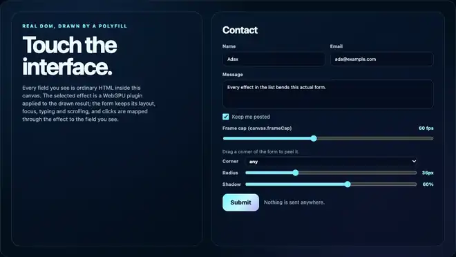

# page-curl

The HTML drawn in a canvas becomes a sheet of paper you can take by a corner and turn: grab a corner and the live page folds and rolls up under your hand in 3D, lit and shadowed, still updating; it springs back on release.

An **example** effect plugin of this library, not part of the polyfill: nothing in `src/` imports it, and the polyfill, the frame cap and the effects host work without it. The effects host and its plugins are extensions of this library, not part of the HTML-in-Canvas proposal; native implementations do not provide them ([details](../../docs/guides/EFFECTS-PLUGINS.md#extensions-not-the-standard)).



Recorded in headless Chrome from the plugin gallery (`node plugins/page-curl/test/gallery.e2e.mjs --record`).

## What it does

It applies to any drawable, with no change to the HTML.

- **A 3D sheet.** The page is folded along a straight line and rolled around a cylinder under the held corner: the part between the bound edge and the fold stays flat, the roll lifts, the part beyond it lies back side up, with the held corner exactly under the pointer. The sheet is bound along the edge opposite the corner. Rolling never stretches the sheet, so the paper keeps its proportions (the tests measure it). A long pull bows the sheet into a larger loop.
- **Seen and lit.** A camera straight above the page with a little perspective, one lamp from the upper left: the roll brightens where it faces the lamp and darkens where it turns away, and a soft sheen runs along it.
- **Shadows.** The lifted paper casts a soft shadow on the page underneath and on the flat part of the sheet, and its penumbra widens with the height of the paper (sharp where the roll meets the page, soft under the raised flap).
- **The back of the sheet is paper**, with the page's content showing through it, soft and mirrored, as ink shows through real paper.
- **Live.** The sheet samples the live page every frame: typing into a field while the page is held curled shows the text on the curling sheet; the flat part stays usable at any time.
- **Physics-like follow.** The corner follows the pointer on a spring and springs back when released. The springs run in fixed steps on the frame clock, so a pose depends on the time only, at any frame cap.
- **Affordances.** At rest one corner (`corner`, else top-right) is a small dog-ear that peeks open by itself every `autoPeek` seconds until the first drag, and on demand with the action `peek`; hovering a corner lifts it further with a `grab` cursor (`grabbing` while dragging). The plugin's controls show the hint "Drag the top-right corner to turn the page (any corner works)".
- **The page underneath** is plain paper, faintly ruled (`under`).

## Usage

```html
<script src="dist/hic-live-polyfill.iife.min.js"></script>
<script src="dist/hic-live-effects.iife.min.js"></script>
<script src="dist/plugins/page-curl.iife.min.js"></script>   <!-- window.HicLivePlugins['page-curl'] -->
<script type="module">
  const host = await HTMLInCanvasEffects.createHost(canvas, form, { interposer: true });
  const curl = await host.addPlugin(HicLivePlugins['page-curl'].plugin, { corner: 'any', radius: 48 });
  curl.mountUI(document.getElementById('controls'));   // the hint label, corner, roll and shadow controls
  helpButton.addEventListener('click', () => curl.trigger('peek'));   // show again that the page can be turned
</script>
```

ES modules: `import { plugin } from '@giuseppe-scotto-lavina/html-in-canvas-polyfill/plugins/page-curl'`.

## Options

| option | default | |
|---|---|---|
| `corner` | `'any'` | `'any'`, `'tl'`, `'tr'`, `'bl'`, `'br'`: which corners can be grabbed |
| `radius` | 48 | 4 to 200 CSS px (slider 12 to 120): the roll radius; a long pull bows it up to 1.9 times larger, a short pull uses a tighter one (at most pull / pi) |
| `shadow` | 0.85 | 0 to 1: strength of the shadows |
| `dogEar` | 36 | 0 to 120 CSS px: how far the dog-eared corner is folded at rest (per axis); 0: no dog-ear |
| `autoPeek` | 5 | seconds between the dog-ear's peeks until the first drag; 0 or `false`: off |
| `hotZone` | 64 | 16 to 200 CSS px: grab distance from a corner |
| `under` | `#d1c9bb` | the page underneath (`'#rrggbb'`) |
| `paper` | `#f6f2e9` | the back of the sheet (`'#rrggbb'`) |

`mountUI` adds the hint label, a corner picker and sliders for the roll and the shadow.

## Actions

`handle.trigger('peek')` ([semantics](../../docs/guides/EFFECTS-PLUGINS.md#5-actions-trigger-and-settled)); no options.

| action | | resolves with |
|---|---|---|
| `peek` | the dog-eared corner opens and closes once now (1.8 s, the motion of the auto-peek), also after the first drag stopped the auto-peek | `'rest'`, once the sheet lies still again |

`handle.settled()` resolves with `'rest'` once nothing moves (no drag, no spring, no peek). While a corner is held or springs back, `peek` opens nothing and resolves at the next rest; a newer trigger resolves a pending one with `null`.

## Input

The grab is the plugin's own gesture. Its pointer events are taken in the capture phase at the document, before the host's interposer and the form see them: `preventDefault` (no focus change, no text selection, no compatibility mouse events), `stopImmediatePropagation`, the pointer is captured to the live layer, and the click that follows the release is swallowed. The form never sees the drag; keyboard input still reaches the focused field.

Every other pointer goes through the host's interposer and this plugin's input mapper, `mapCurlPoint(state, point)`, the twin of what the shader draws, with the same camera:

| presented pixel shows | mapper returns |
|---|---|
| the flat part of the page | the same point (identity) |
| the front of the roll, where it faces the reader | the exact page point it shows (the line of sight is intersected with the cylinder; the nearest crossing inside the sheet is the one seen) |
| the back of the sheet (the roll, the folded flap, the dog-ear) | `NO_TARGET` |
| the page underneath | `NO_TARGET` |

`NO_TARGET` is the effects ABI value for "no element here" (re-exported by this plugin): the host swallows a press there and the mapper chain stops at it.

## Reduced motion

With `prefers-reduced-motion: reduce`: the drag still curls the page (it follows the hand, without the spring's lag); the dog-ear stays still (no auto-peek, and `peek` opens nothing and resolves `'rest'` at once); the release lays the page back at once and the hover lift appears without animation.

## Performance

`test/page-curl-gpu.browser.test.mjs`, headless Chrome on an Apple M1 Max (Metal), 2200x1240 backing pixels (the gallery canvas at DPR 2), the page curled, while other work ran on the machine: 0.81 ms per frame submitted back to back (the one-sample template pass: 0.09 ms), a tenth of the 8.33 ms frame at 120 Hz. One run on one machine.

Per curled frame, all on the GPU and nothing allocated: the lifted paper as the lamp sees it (half resolution, only when the fold moved), two soft copies of it (six separable Gaussian passes, about 4 and 24 CSS px) for contact-hardening shadows, then the page underneath and the sheet as a triangle strip in the fold's frame (4x MSAA, a depth buffer, the cut edges antialiased by alpha to coverage). At rest without a curl (`dogEar: 0`) the pass draws the source unchanged. Frames are requested only while something moves (drag, release, hover lift, a peek); at rest the plugin costs nothing (one timer for the next auto-peek, until the first drag).

## Limitations

- What lies beneath the sheet is plain paper: a plugin receives one source texture, so it is not another live page.
- A touch drag on a corner may be claimed by the browser for scrolling (`pointercancel` releases the page); `touch-action: none` on the drawable keeps it for the plugin.
- After a GPU device loss the gesture in progress is dropped and the page shows flat; a pending `peek` resolves `null`.
- WebGPU only (without an adapter `createHost` rejects with a `NotSupportedError`). Runs over the polyfill and over a browser's own HTML-in-Canvas implementation ([what differs there](../../docs/guides/EFFECTS-PLUGINS.md#on-a-native-implementation)); not run there by the test suites (the native suite runs water, CRT and disintegrate); expected to behave the same, as the plugin uses only the plugin interface.

## Files and tests

| file | |
|---|---|
| `index.js` | `meta`, `plugin`, `ACTIONS`, the mapper `mapCurlPoint`, `poseState`, `foldSpan`, `stateOf`, `hotCorner`, `hintCorner`, `hintText`, `peekAt`, `peekOnce`, `rollFor`, `NO_TARGET`, `isNoTarget` |
| `fold.js` | the shape of the sheet as pure math (fold, normal, the corner's constraints, the camera, the spring) |
| `page-curl.wgsl`, `blur.wgsl` | the shaders; inlined into the built bundles |
| `wgsl.js` | loads the `.wgsl` files when the plugin runs from source; the build replaces it |
| `media/page-curl.webp` | the recording above |
| `test/page-curl.test.mjs` | Node: the folder contract; the fold (an isometry, the corner under the pointer, the bound edge flat); the mapper against an independent forward rendering of the sheet, 8 poses, every pixel; the grab; the spring; the release at 120/30/15 fps; reduced motion; frozen mappers; no allocation per frame; the dog-ear, hover, grab cursor, auto-peek; the action `peek` through the real handle (it peeks, also after the first drag, waits while a corner is held, resolves `'rest'`, does nothing with reduced motion, removal) |
| `test/page-curl-gpu.browser.test.mjs` | headless Chrome, the real host: `checkMapperAgainstGpu` (identity as positive control), a pose 20 px away as wrong-mapper control, the back of the sheet, the dog-ear, the spring back to the plain source, the action `peek` (`runActionOnGpu`: every checked frame agrees with its mapper, it ends on the dog-ear), device loss, the GPU time |
| `test/gallery.e2e.mjs` | the gallery with trusted input: the hint, the dog-ear and its auto-peek, hover, a drag that the form never sees, typing while the page is held curled, the release, clicks map again, the action `peek` from the gallery's button, an unknown action, superseding, `settled()`, the frame cap, reduced motion (also the action). 26 of 26 checks pass (headless Chrome 155, 2026-10-16). `--record` writes the media; needs `npm run build` |
