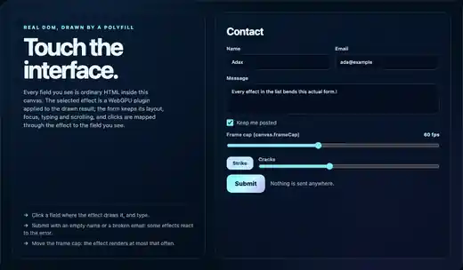

# shatter

An **example** effect plugin: the HTML drawn in a canvas sits behind a pane of glass that takes two impacts. The first cracks it, and the form stays visible and usable through the cracked glass; the second breaks it: the shards fall out in 3D, then fly back into place and the cracks close. It shows how to use the effects extension of this library (`HTMLInCanvasEffects`, plugin ABI v2). It is **not part of the polyfill**: the polyfill, the frame cap and the effects host work without it, and nothing in `src/` imports it.

The effects host and this plugin are extensions of this library. They are not part of the HTML-in-Canvas proposal, and browsers' native implementations do not provide them ([docs/guides/EFFECTS-PLUGINS.md](../../docs/guides/EFFECTS-PLUGINS.md)).



`media/shatter.webp` was recorded in headless Chrome from the plugin gallery: two trusted clicks on Submit with an invalid email (`node plugins/shatter/test/gallery.e2e.mjs --record`).

## What it looks like

1. **First impact: the glass cracks.** From the impact point (where you pressed, or the invalid field) a spiderweb runs out in 450 ms: jagged radial cracks to the edges of the canvas, rings around the impact that are whole near it and more and more broken farther out, crushed glass and a flash at the impact, a few chips flying. Each piece shifts a few pixels away from the impact (more near it), the picture bends along every broken edge (a 7 px bevel that acts as a lens), the fractures catch the light unevenly, and the pieces, each at its own slight tilt, show their own glints. The form is still there, and **usable through the glass**: the input mapper is the exact inverse of the offsets and of the bending, so a click lands on the control drawn under the pointer, and the cracked pane redraws the live form as you type.
2. **Second impact: the pane breaks.** A flash, then the shards fall away from the impact in 3D perspective: out and towards the viewer, turning about tilted axes, falling under gravity, lit on their faces (darker seen from behind, where the form shows mirrored), with bright edges that thicken as they turn edge-on, slight motion blur (two fainter copies a few ms behind) and small debris. The empty backdrop is left.
3. **Then it rewinds.** The shards fly back up into place with the live form (the page's error state), and the cracks close back into the impact point.

A valid submit while the pane is cracked heals it (the cracks close) without breaking it.

## Use

```html
<script src="dist/hic-live-polyfill.iife.min.js"></script>
<script src="dist/hic-live-effects.iife.min.js"></script>
<script src="dist/plugins/shatter.iife.min.js"></script>   <!-- window.HicLivePlugins.shatter -->
<script>
  const host = await HTMLInCanvasEffects.createHost(canvas, form, { interposer: true });
  const handle = await host.addPlugin(HicLivePlugins.shatter.plugin, { onSubmit: 'invalid' });
  await HicLivePlugins.shatter.trigger(canvas, 'impact', { x: 120, y: 80 });   // cracks (impact point in canvas css px)
  await HicLivePlugins.shatter.trigger(canvas, 'impact');                      // breaks it, it flies back
</script>
```

ES modules: `import { plugin, trigger } from '@giuseppe-scotto-lavina/html-in-canvas-polyfill/plugins/shatter'`.

Ways to start it:

| how | |
|---|---|
| `trigger(canvas, action, point?)` | `'impact'`: cracks an intact pane, breaks a cracked one (`'play'`). `'crack'`: cracks and stays cracked. `'out'`: breaks and stays gone (an intact pane cracks within the first moments of the fall). `'in'`: flies back and closes the cracks; on a cracked pane, closes them. `'play'`: out, a 300 ms pause, in. `point` is the impact in canvas css px. Returns a promise: `true` when that end state is reached, `false` when another request superseded it, the plugin was removed, nothing can happen (a crack while shards fall, or with reduced motion), or no instance runs on that canvas. |
| `handle.setOptions({ state })` | `'cracked'`, `'out'` or `'in'`: the same, declaratively, through the handle of `addPlugin`. Only a change of `state` starts something. |
| `onSubmit: 'invalid'`, `'valid'` or `'always'` | a `submit` event inside the source that matches (`'invalid'`: a field matches `invalidSelector` at that moment) is an impact: the first cracks, the next one breaks the pane. A submit that does not match heals a cracked pane. The page's own submit handler runs first when it was added before the plugin (the gallery's is), so the form shows the error state the page set. A submit while the cracks run or shards fall does nothing. |
| the Strike button of `mountUI` | `'impact'`, from the button |

The impact point, when no `point` is given: the last pointer press on the canvas within 1.5 s (the Submit or Strike button that was clicked), else the centre of the first invalid field (a submit with the Enter key) or of the button that submitted, else the `impact` option, else the canvas centre. The second impact breaks the pattern that the first one cracked.

What it shows: the cracked pane and the way back sample the live source (typing shows through the cracks; the form comes back with the page's latest state). When the pane breaks, the plugin copies the picture the user sees at that moment (one render pass into its own texture), and the falling shards are cut from that copy. The last frame of the way back is drawn with the host's passthrough formula, so it equals the frame the host presents without any plugin, bit for bit (checked on the GPU).

## Input

The plugin is `spatial`, so it supplies `captureInputMapper`. Its mapper depends on the frame that was presented:

- **intact**: the identity. The form is fully usable, the host's interposer passes every pointer event through.
- **cracked and still**: the inverse of the pane (`crackedSource` in `shards.js`). For a presented point it finds the piece drawn there (the later piece where two shifted pieces overlap, as on the GPU), removes that piece's offset and, within 7 px of a crack, the bending of the bevel; inside an open crack (where the dimmed picture shows in place) it is the identity. A click, a focus, typing, a checkbox all work through the cracked glass. The mapper is made once per crack pattern, not per frame.
- **while the cracks run or close, and from the second impact until the form is back** (including the reduced-motion crossfade): pointer input is **blocked**. The mapper returns `NO_TARGET` (the effects ABI value for "no element here"), so the host swallows the press: no focus change (the focused field keeps the focus), nothing activated, the click swallowed. Falling shards are not hit-tested.

Keyboard input is not mapped by the host: a key pressed during a transition reaches the element that had the focus before it.

## Options

| option | default (gallery) | |
|---|---|---|
| `cracks` | 13 | radial cracks, 6 to 24 |
| `duration` | 1600 | ms of one way of the fall (out or in), 300 to 8000; one way plays 1.7 s of physics |
| `gravity` | 1 | 0.2 to 3 (1 = 2400 css px/s²) |
| `refraction` | 1.6 | 0 to 4: css px the picture bends at a crack |
| `edgeColor`, `edgeAmount` | `#d9f5ff`, 0.85 | the fractures, the crushed glass, the edges of falling shards and the flash (0: geometry only) |
| `glint` | 0.8 | 0 to 1: the light the pieces and the falling shards catch |
| `backdrop` | the host's clear colour | what is left behind (`#rrggbb` or `[r, g, b]` 0..1) |
| `onSubmit` | `'off'` (`'invalid'`) | `'off'`, `'invalid'`, `'valid'`, `'always'` |
| `invalidSelector` | `:invalid, [aria-invalid="true"], .invalid` | what counts as an invalid field |
| `intro` | false (true) | when created, the shards fly into place once the first snapshot is there (skipped when re-created after a device loss) |
| `state` | `'in'` | `'cracked'`, `'out'`, `'in'`: see above |
| `impact` | the canvas centre | `{x, y}` css px: the impact when there is no pointer press and no field |
| `reducedMotion` | follows `prefers-reduced-motion` | `true` / `false` to force it |
| `seed` | 7 | the crack pattern (each crack adds one) |

`mountUI` adds a Strike button and a slider for the number of radial cracks.

## Geometry, physics, frame cap, device loss

- **Cracks.** `spiderweb` in `shards.js`: radial cracks at jittered angles, ring radii growing about 1.6x per ring with jittered vertices on each spoke and broken arcs between them; beyond the second ring a ring segment is missing more and more often, and the cells on both sides of a missing one are one shard. Every cell is clipped to the canvas: the cells are an exact partition of it (checked for many impacts and seeds). Each cell becomes a triangle fan from a point that sees every edge from inside (a cell no point sees whole is cut into ears, each fanned from its own centre: never drawn inside out, never dropped). This runs on the CPU once per crack (about 3 ms at most, on the frame that builds it), never per frame.
- **Drawing.** One preallocated vertex buffer (per vertex: position, shard and border flag, an edge factor that is 1 at the fan centre and 0 on the outer edge, the inward normal of that edge and its distance to the fan centre, so the fragment shader knows its distance to the crack exactly); the parameters of up to 160 shards in the uniform block (4 vec4 each: centre and crack offset, velocity and start, spin axis and rate, tilt and distance). The vertex shader moves a shard as a function of time only: in the pane it is exactly home + offset (the mapper's formula); falling, it is rotated about its axis (Rodrigues), moved, pulled by gravity and projected in perspective about the canvas centre. `shardPoint` in `shards.js` is the JavaScript twin. Debris is one instanced triangle per chip, also a function of time.
- **One clock per stage.** The cracks have their own 450 ms clock; the fall has the out/in timeline of `../_lib/transition.js`. A fall that starts from an intact pane cracks it in its first tenth; on the way back the cracks close in its last tenth, after every shard is home.
- **No per-frame allocation.** A frame writes a preallocated 28-float header into the uniform buffer and reuses its render pass descriptor and the object of the header values; bind groups are cached per texture view; the mapper of a cracked pane is one function per crack.
- **Frame cap.** Both clocks are driven by `frame.now` and start at the first frame rendered after the request, so the same instant looks the same at any cap (checked at 120 Hz and 15 fps). The instance is `continuous` only while something moves; a cracked, still pane renders only when the page changes.
- **`prefers-reduced-motion: reduce`**: nothing cracks or falls; an impact crossfades the picture to the backdrop and back.
- **Device loss.** The host creates the plugin again on the new device with the latest options; the new instance starts intact, without the intro, and promises of the lost instance resolve `false`.

## Measured

On one machine (Apple M1 Max, macOS, headless Chrome, Metal, other work running on the machine), with timestamp queries on the plugin's pass at 2200x1240 backing pixels (the gallery canvas at DPR 2), frames 8.33 ms apart: GPU time of the pass p50 0.26 ms, p95 0.59 ms while the cracks run and on the cracked pane; p50 0.20 ms, p95 0.59 ms, max 0.92 ms while shards fall; intact p50 0.33 ms. `render()` on the CPU p95 0.01 ms, 2.9 ms once per crack (the frame that builds the pattern). Chrome quantises timestamps, and these numbers come from one run: they say the pass fits a 120 Hz frame (8.33 ms) on this machine, nothing about others. `test/shatter-perf.browser.test.mjs` prints them again.

## Files

| file | |
|---|---|
| `index.js` | `meta`, `plugin`, `trigger`, and the pure helpers the tests use (`readOptions`, `fillHeader`, `crackFront`) |
| `shards.js` | pure: the crack pattern, cells, fans, shard parameters, the mapper of the cracked pane (`crackedLayout`, `crackedSource`), `shardPoint` |
| `../_lib/transition.js` | shared with the disintegrate plugin, bundled into each: the out/in timeline, the two constant mappers, option parsing, the invalid-field probe (pure) |
| `shatter.wgsl` | the shader: full-screen pass (intact frame, the dimmed picture in the open cracks, crossfade, freeze copy), the shards (pane and fall), the debris |
| `wgsl.js` | loads the `.wgsl` file when the plugin runs from source; the build replaces it |
| `media/shatter.webp` | the recording above |
| `test/shatter.test.mjs` | Node: the folder contract, the partition and the fans for many impacts and seeds, whole inner and broken outer rings, border flags, offsets and fall start, the mapper of the cracked pane (exact inverse inside a piece, identity in an open crack), `shardPoint`, options and the header, and a fake GPU (no GPU object per frame, one pattern per crack, the two impacts and their mappers, the impact point from pointer / invalid field / option / centre, submit wiring incl. healing, reduced motion, destroy) |
| `test/shatter-gpu.browser.test.mjs` | headless Chrome, real host and GPU: intact frame = passthrough bit for bit; the cracked pane's mapper against the GPU pixels (`checkMapperAgainstGpu`: 0 wrong pixels, the identity wrong on over a thousand); a click through the cracked glass reaches the button (and is swallowed while the cracks run); cracks first near the pointer; the second impact: mid frames moving, input blocked, the end bit for bit; 120 Hz vs 15 fps cap; reduced motion; device loss; intro and submit wiring (crack, break, heal) |
| `test/shatter-perf.browser.test.mjs` | the GPU time measurement above |
| `test/gallery.e2e.mjs` | the plugin in the real gallery with trusted input: idle click-through and typing; an invalid Submit cracks it, a click through the cracks focuses the message field and typing shows; a second invalid Submit breaks it, a click during the fall changes nothing, it comes back with the error state and is usable; the Strike button cracks, a valid Submit heals; `--record` writes the media. Needs `npm run build`; `npm run test:plugins` runs every gallery e2e. |
